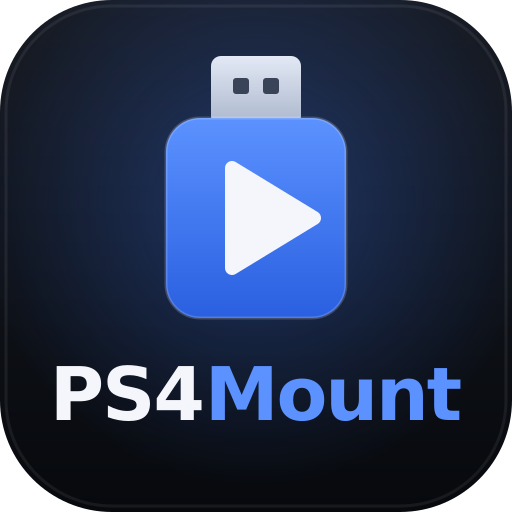

<p align="center"></p>

# PS4Mount PS4

Juega a tus paquetes de PS4 desde un USB, la memoria de la consola o un NAS sin instalar una segunda copia del juego. El panel web te muestra qué está listo, qué necesita reiniciar y cuánto espacio tienes libre.

Play your PS4 packages from a USB drive, the console's storage, or a NAS without installing a second copy of the game. The web panel shows what is ready, what needs a restart, and how much space is free.

[Español](#español) · [English](#english) · [Descargas / Releases](https://github.com/Vld439/PS4Mount-PS4/releases)

## Español

### Empieza a jugar

Necesitas una PS4 con jailbreak y GoldHEN, paquetes fake de PS4 de tus propios juegos y, para abrir el panel, un móvil o un ordenador en la misma red de confianza.

1. Descarga `ps4mount-ps4.bin` y cópialo a `/data/payloads/` en la consola. [Descargas](https://github.com/Vld439/PS4Mount-PS4/releases)
2. Pon los paquetes del juego y su actualización en la carpeta `PS4Mount` de un USB exFAT. Si usas la memoria de la consola, ponlos en `/data/PS4Mount`.
3. Carga PS4Mount con GoldHEN y abre en tu navegador la dirección `http://<IP-de-la-PS4>:8770` que aparece en el aviso de la consola.
4. Espera a que el juego aparezca en la pantalla de inicio. Si el panel dice **Reinicia para jugar**, reinicia la PS4 una vez y vuelve a cargar PS4Mount. La consola lee al arrancar la información que necesita para iniciar un juego recién añadido.

PS4Mount debe estar en marcha cuando juegues. En navegadores antiguos, puedes abrir la vista ligera en `/legacy`. Si desconectas la unidad, el icono puede seguir en la pantalla de inicio. Conecta la unidad y espera a que el panel vuelva a indicar **Listo** antes de jugar.

### Almacenamiento y DLC

| Si quieres… | Qué elegir y qué ocurre |
| --- | --- |
| Conservar tus carpetas y nombres | Desactiva **Organizar**. PS4Mount usa los paquetes donde están. En una configuración nueva, **Organizar** está activado y mueve los paquetes encontrados a `ps4/<TITLE_ID>/` en la misma unidad. |
| Usar un NAS | Comparte una carpeta por SMB o NFS y configura el servidor y el recurso en **Ajustes → NAS**. El recurso se usa en modo de solo lectura. |
| Ahorrar espacio con los DLC | El modo **Montar desde la unidad de origen** evita duplicar los paquetes de DLC. PS4Mount guarda sus metadatos en la consola. Este modo está pendiente de verificar en hardware. |
| Instalar los DLC en la consola | Elige **Memoria de la consola**. Los DLC de hasta 256 MB pasan por el instalador del sistema. Puedes activar también los de mayor tamaño. Es el modo que conservan las configuraciones antiguas que ya tenían los DLC activados. |
| Desactivar los DLC de PS4Mount | Elige **Apagado**. Los DLC que ya instaló el sistema siguen instalados. |
| Quitar un juego y conservar los paquetes | En el panel, pulsa **Quitar de la biblioteca**. Si PS4Mount organizó tus paquetes y quieres recuperar sus nombres y carpetas, usa **Restaurar archivos originales**. |

**Borrar desde el menú de la PS4 puede borrar los paquetes de un juego organizado por PS4Mount y liberar ese espacio.** Con **Organizar** desactivado o con un juego en el NAS, los paquetes se quedan donde están. Las instalaciones normales siguen bajo control del sistema.

En **Ajustes** puedes consultar cuánto ocupan los paquetes enviados para instalar, el log y los datos de la biblioteca. La limpieza automática de copias temporales queda registrada en el log.

### Envíos, descargas y copias

- **Enviar juegos** comprueba el paquete y el espacio del destino antes de enviar el archivo entero. Usa **Enviar e instalar** para las aplicaciones homebrew que deban pasar por el instalador de la consola.
- **Descargar enlaces** acepta enlaces directos a paquetes, ZIP y RAR. Pega todas las partes de un archivo multipartes y proporciona la contraseña si la tiene. Para archivos con contraseña, usa ZIP o RAR5. La consola sigue descargando cuando cierras el panel. La extensión de escritorio es opcional y se distribuye con las [descargas](https://github.com/Vld439/PS4Mount-PS4/releases).
- **Google Drive** permite guardar y recuperar copias desde la consola. Activa la API de Drive en tu proyecto de Google Cloud, crea un cliente OAuth de tipo **TV y dispositivos de entrada limitada** y añade tu cuenta como usuario de prueba si el proyecto está en modo de prueba. En el panel, guarda el ID y el secreto del cliente y sigue el aviso de inicio de sesión. La consola guarda las credenciales.

### Compatibilidad y funciones en prueba

El uso desde USB exFAT, incluidos paquetes de más de 4 GB, y la biblioteca de la memoria interna tienen pruebas previas en PS4. La referencia principal es **firmware 13.52 con GoldHEN**. El NAS tiene pruebas previas en **13.52 y 6.72**. El uso de NAS en **14.00** queda fuera de esas pruebas.

- **AutoRun de GoldHEN.** Si el panel encuentra el archivo del payload, **Arrancar con la consola** añade su entrada a la lista de GoldHEN. Activa también **Enable AutoRun** en GoldHEN. La configuración preserva las otras entradas. Falta confirmar el arranque automático en hardware para esta versión.
- **Clásicos de PS1, PS2 y PSP.** PS4Mount reconoce determinados clásicos empaquetados como juegos de PS4. El arranque de esos paquetes está pendiente de verificar en consola.
- **ROM de emuladores.** El montaje experimental presenta carpetas del USB al emulador. Por ejemplo, pon las ROM en `PS4Mount/emulators/PS4SX2/roms` y abre primero PS4SX2 para que cree su carpeta. PS4Mount solo monta sobre un destino vacío. El emulador sigue siendo quien abre la ROM. Falta verificar el montaje y la reconexión en hardware.

### Si algo falla

Abre **Log** en el panel y busca la acción que falló. Si el juego se acaba de añadir, comprueba el aviso de reinicio. Si falta una unidad, vuelve a conectarla y espera a que reaparezca. Puedes analizar una copia del log con `python3 tools/logcheck.py log.txt`.

El panel usa HTTP y se abre sin contraseña. Limítalo a tu red de confianza y mantén el puerto 8770 fuera de Internet. PS4Mount está en beta. Conserva una copia de tus partidas.

Para informar de un problema, indica el firmware, la versión de PS4Mount y el mensaje relevante del log. Revisa que el fragmento esté libre de datos privados. [Incidencias](https://github.com/Vld439/PS4Mount-PS4/issues)

## English

### Start playing

You need a jailbroken PS4 running GoldHEN, PS4 fake packages from games you own, and a phone or computer on the same trusted network to open the web panel.

1. Download `ps4mount-ps4.bin` and copy it to `/data/payloads/` on the console. [Releases](https://github.com/Vld439/PS4Mount-PS4/releases)
2. Put your game packages and updates in the `PS4Mount` folder of an exFAT USB drive. To use console storage, put them in `/data/PS4Mount`.
3. Load PS4Mount with GoldHEN and open the address from the console notification in your browser. It looks like `http://<PS4-IP>:8770`.
4. Wait for the game to appear on the home screen. When the panel says **Restart to play**, restart the PS4 once and load PS4Mount again. The console reads the information it needs to start a newly added game at boot.

Keep PS4Mount running while you play. For older browsers, open the lightweight panel at `/legacy`. If you disconnect a drive, the game's icon can stay on the home screen. Reconnect the drive and wait for the panel to show **Ready** before starting the game.

### Storage and add-ons

| If you want to… | What to choose and what happens |
| --- | --- |
| Keep your folder layout and names | Turn **Organize** off. PS4Mount uses the packages where they are. A new setup starts with **Organize** on and moves discovered packages to `ps4/<TITLE_ID>/` on the same drive. |
| Use a NAS | Share a folder over SMB or NFS and enter the server and share in **Settings → NAS**. PS4Mount uses the share in read-only mode. |
| Save space on add-ons | **Mount from the source drive** avoids a second copy of the add-on packages. PS4Mount stores metadata on the console. This mode awaits hardware verification. |
| Install add-ons on the console | Choose **Console storage**. The system installer handles add-ons up to 256 MB. You can also enable larger add-ons. Older configurations with add-ons enabled keep using this mode. |
| Disable PS4Mount add-ons | Choose **Off**. Add-ons already installed by the system stay installed. |
| Remove a game and keep its packages | In the panel, choose **Remove from library**. If PS4Mount organized your packages, use **Restore original files** to recover their original names and folders. |

**Deleting a game from the PS4 menu can delete the packages PS4Mount organized for that game and free that space.** With **Organize** off or for a game on a NAS, its packages stay where they are. Ordinary game installations remain under the system's control.

In **Settings**, you can see the space taken by packages sent for installation, logs, and library data. The log records automatic cleanup of temporary copies.

### Sends, downloads, and backups

- **Send games** checks the package and destination space before sending the whole file. Use **Send and install** for homebrew apps that need the system installer.
- **Download links** accepts direct links to packages, ZIP, and RAR files. Paste every part of a multipart archive and supply its password if needed. Use ZIP or RAR5 for password-protected archives. The console keeps downloading when you close the panel. The optional desktop browser extension is available in [Releases](https://github.com/Vld439/PS4Mount-PS4/releases).
- **Google Drive** backs up and restores packages from the console. Enable the Drive API in your Google Cloud project and create an OAuth client for **TVs and Limited Input devices**. Add your account as a test user if the project is in testing. Save the client ID and secret in the panel and follow the sign-in prompt. The console stores the credentials.

### Compatibility and experimental features

Previous PS4 testing covers exFAT USB drives, including packages larger than 4 GB, and the console-storage library. The main tested setup is **firmware 13.52 with GoldHEN**. NAS support has prior console testing on **13.52 and 6.72**. Those earlier NAS tests did not cover **14.00**.

- **GoldHEN AutoRun.** When the panel finds the payload file, **Start with the console** adds it to the GoldHEN list. Also turn on **Enable AutoRun** in GoldHEN. Setup preserves other entries. Boot-time behavior in this version awaits hardware verification.
- **PS1, PS2, and PSP Classics.** PS4Mount recognizes certain Classics packaged as PS4 games. Starting these packages on a console still needs testing.
- **Emulator ROMs.** The experimental mount makes drive folders visible to an emulator. For PS4SX2, put ROMs in `PS4Mount/emulators/PS4SX2/roms` and open PS4SX2 first so it creates its folder. PS4Mount mounts over an empty destination. The emulator opens the ROM. Mounting and reconnecting still need hardware verification.

### If something goes wrong

Open **Log** in the panel and find the failed action. For a game you just added, check the restart notice. If a drive is missing, reconnect it and wait for it to reappear. To read a copy of the log in English, run `python3 tools/logcheck.py --lang en log.txt`.

The panel uses HTTP and opens without a password. Keep it on a trusted network and keep port 8770 off the public internet. PS4Mount is in beta. Keep a backup of your saves.

When reporting an issue, include your firmware, PS4Mount version, and the relevant log message. Check that the excerpt is free of private data. [Issues](https://github.com/Vld439/PS4Mount-PS4/issues)

## Desarrollo / Development

Use the SDK revision pinned by the build workflow to build the PS4 payload. See the project workflow for setup, verification, and console diagnostics. [Build workflow](.github/workflows/build.yml) · [Development guide](AI-WORKFLOW.md) · [Specifications](specs/)

```sh
bash test/run.sh
bash test/policy.sh
bash test/sdkcheck.sh
(cd test/web && npm test)
PS4_PAYLOAD_SDK=/path/to/sdk bash build.sh
```

## Créditos y licencia / Credits and license

PS4Mount PS4 is a PS4 port of gasb07's [PS4Mount](https://github.com/gasb07/ps4mount). The project is unofficial. PlayStation and PS4 are trademarks of Sony Interactive Entertainment.

The port draws on [LibOrbisPkg](https://github.com/maxton/LibOrbisPkg), [ps4-payload-sdk](https://github.com/ps4-payload-dev/sdk), flatz's [PS4 stubs](https://github.com/flatz/ps4_stub_lib_maker_v2), [ps4-ipi](https://github.com/0x199/ps4-ipi), and [ShadowMountPlus](https://github.com/drakmor/ShadowMountPlus). Third-party components include SQLite, BearSSL, the Mozilla CA list, libarchive, zlib, libsmb2, libnfs, and libfuse with the PS4 port from Itemzflow.

Distributed under the [GNU GPL v3 or later](LICENSE).
