<p align="center">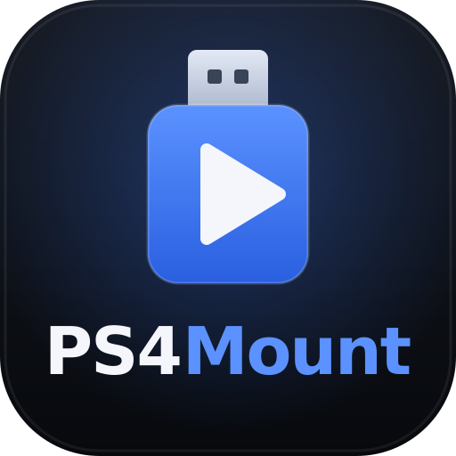</p>

# PS4Mount PS4

**Juega pkgs fake de PS4 desde un USB o desde la memoria de la consola, sin instalarlos.**
**Play PS4 fake pkgs from a USB drive or from the console's storage, without installing them.**

**[Español](#español) · [English](#english)**

PS4Mount PS4 es un port, exclusivo para PS4, de [PS4Mount](https://github.com/gasb07/ps4mount) de **gasb07** (para PS5).
PS4Mount PS4 is a PS4-only port of [PS4Mount](https://github.com/gasb07/ps4mount) by **gasb07** (for the PS5).

*Proyecto no oficial, sin relación con Sony Interactive Entertainment. PlayStation y PS4 son marcas de Sony Interactive Entertainment. Úsalo solo con juegos que te pertenecen.*
*Unofficial project, not affiliated with Sony Interactive Entertainment. PlayStation and PS4 are trademarks of Sony Interactive Entertainment. Only use it with games you own.*

---

<a name="español"></a>
# Español

PS4Mount es un payload para una PS4 con jailbreak. Pones los pkgs del juego (y su actualización y sus DLC) en un USB o en la memoria de la consola, y PS4Mount los añade a la pantalla de inicio para jugarlos **desde el pkg, sin instalarlos**: no hay que esperar a una instalación ni gastar espacio en una segunda copia.

Además tiene un **panel web** (desde el móvil o el PC) con tu biblioteca, portadas y fichas de cada juego, **envío de juegos desde el PC por la red local** (cada pkg se comprueba antes de enviarlo, para no pasar horas enviando un juego que la consola no puede usar) y **copias en tu Google Drive**: la consola sube tus juegos a tu Drive y los vuelve a bajar, sin PC. Hay una versión sencilla del panel para navegadores antiguos, sin probar todavía en el de la PS4.

Probado en una PS4 con firmware **13.52** y GoldHEN. El panel y las notificaciones están en **español e inglés**: salen en el idioma de la consola (inglés si no es ninguno de los dos), y se puede cambiar en **Ajustes → Idioma**.

> [!WARNING]
> **Versión beta.** Haz una copia de seguridad de tus partidas guardadas antes de usarlo, y [cuéntanos cualquier problema](#problemas-frecuentes) con el log.

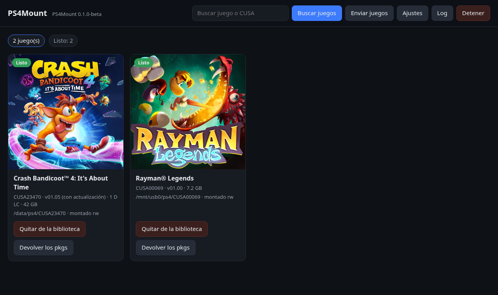

## Qué funciona y qué no

| | Estado |
| --- | --- |
| Juegos desde un **USB exFAT** (también pkgs de más de 4 GB) | ✅ probado |
| Juegos desde la **memoria interna** (`/data/PS4Mount`) | ✅ probado |
| Juegos desde una **NAS** por **SMB o NFS**, solo lectura, con búsqueda en la red | ✅ probado (solo firmware 13.52) |
| **Actualizaciones** | ✅ probado |
| Juegos **donde están**, sin mover ni renombrar los pkgs (cualquier carpeta de la unidad) | ✅ probado |
| **DLC** de hasta 256 MB (casi todos: trajes, packs, licencias) | ✅ probado: PS4Mount los instala con el instalador del sistema en segundos, y aparecen en la información del juego |
| DLC de más de 256 MB | ✅ probado: se instalan solos con el instalador del sistema, en segundo plano (ocupan memoria interna; se puede apagar en Ajustes) |
| **Enviar juegos desde el PC** por la red, con comprobación previa | ✅ probado (unos 16 MB/s por cable) |
| **Borrar** un juego desde la consola | ✅ probado: borra también sus pkgs y libera el espacio |
| **Copias en Google Drive**: subir y volver a bajar juegos desde la consola | ✅ probado: la subida va a la velocidad de tu conexión, la bajada a unos 15 MB/s (el máximo de la PS4) |
| **Descargar desde enlaces**: un pkg, un ZIP o un RAR (también en partes y con contraseña), descargado y descomprimido por la propia consola | ✅ probado en la consola (un juego de 24,6 GB en un RAR con contraseña en 3 partes) |
| **Extensión del navegador**: las descargas de pkg, ZIP y RAR van a la consola | ✅ probado en Brave; Firefox sin probar |
| Un juego **nuevo**, o una actualización que llega después del juego | ⚠️ necesita **reiniciar la consola una vez**; después se juega siempre |
| Otros firmwares | ⚠️ sin probar todavía |
| Pkgs **retail** (no fake) | ❌ |
| **Ports homebrew** (juegos sin CUSA, como SMW o SSBU: `SMWR00001`, `SSBU00001`) | ✅ probado: se juegan desde el pkg como un juego, si pesan **1 GB o más** |
| Apps homebrew (tiendas, emuladores…), de menos de 1 GB | ✅ probado: no se juegan desde el pkg, pero **Enviar juegos** las envía y las instala en la consola |

## Requisitos

- Una PS4 con jailbreak y **GoldHEN** (con su BinLoader activado, el puerto 9090).
- **Payload Guest** u otra forma de cargar payloads.
- Pkgs **fake** de PS4 (`CUSA…`).
- Para jugar desde un USB: un disco formateado en **exFAT**.

## Uso

1. **Descarga** `ps4mount-ps4.bin` de [Releases](https://github.com/Vld439/PS4Mount-PS4/releases) y cópialo en **`/data/payloads/`** de la consola (por FTP, o como copies tus otros payloads).
2. **Después de cada arranque**, abre **Payload Guest** y elige PS4Mount. Aparece la notificación `PS4Mount 0.2.0-beta en marcha. Panel en http://<IP de la PS4>:8770`.
3. **Pon los juegos**, de una de estas formas:
   - **En un USB:** copia los pkgs **donde quieras** del disco (por ejemplo en la carpeta `PS4Mount`, o en una carpeta por juego) y conéctalo a la PS4. PS4Mount los busca en todo el disco y los agrupa por el título que llevan dentro (juego, actualización y DLC), sin moverlos ni renombrarlos; las carpetas ocultas y las del sistema no se miran.
   - **Desde el PC:** con **Enviar juegos** en el panel (ver más abajo).
   - **En la memoria interna:** pkgs en `/data/PS4Mount` (por FTP o con Enviar juegos). `/data/pkg` sigue siendo del instalador normal: PS4Mount no lo toca.
4. Espera las notificaciones: `usb0: 1 juego(s) de PS4 encontrado(s), 1 nuevo(s) o actualizado(s)` → `Añadiendo 1/1: <juego>` → `<juego> añadido. Reinicia la consola una vez para jugarlo`.
5. **Reinicia la consola una vez**, vuelve a cargar PS4Mount y juega desde la pantalla de inicio.

Con **Organizar los pkgs en la carpeta ps4** activado (viene apagado), PS4Mount ordena los pkgs que usa en una carpeta por juego, en el mismo disco (es un cambio de nombre, sin copiar nada):

```
ps4/CUSAxxxxx/app.pkg                           juego
ps4/CUSAxxxxx/patch.pkg                         actualización
ps4/CUSAxxxxx/addcont/CUSAyyyyy/<LABEL>/ac.pkg  DLC
```

Si lo activas, mantén esa estructura. Para añadir más juegos, vuelve a ponerlos donde se buscan.

Si apagas **Organizar los pkgs en la carpeta ps4** en Ajustes (es lo que viene por defecto), PS4Mount no mueve ni renombra nada: usa los `.pkg` **donde estén**, en cualquier carpeta de la unidad (también los que ya estén en `ps4/`), y los agrupa por el título que llevan dentro (juego, actualización y DLC). Los pkgs **base+actualización fusionados** funcionan: una actualización suelta más vieja que el juego no se usa.

Al apagarlo, los juegos que PS4Mount **ya había organizado** vuelven solos a su sitio y con su nombre originales (lo recuerda en el `origin.txt` de cada juego) y se usan desde ahí; los que organizaste tú a mano se quedan donde están. La primera vez que se devuelven hay que reiniciar la consola una vez, como al añadir un juego.

### En la consola

El juego aparece en la pantalla de inicio como cualquier otro, y PS4Mount te va avisando de todo con notificaciones: al cargarse, al encontrar y añadir juegos, si falta el disco de un juego, al borrar uno y con las copias en Google Drive.

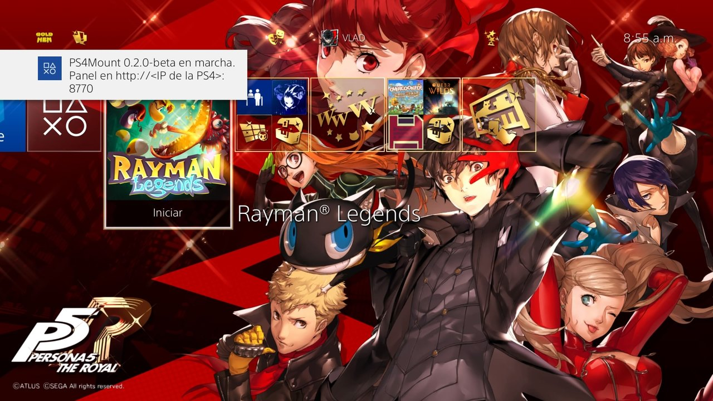

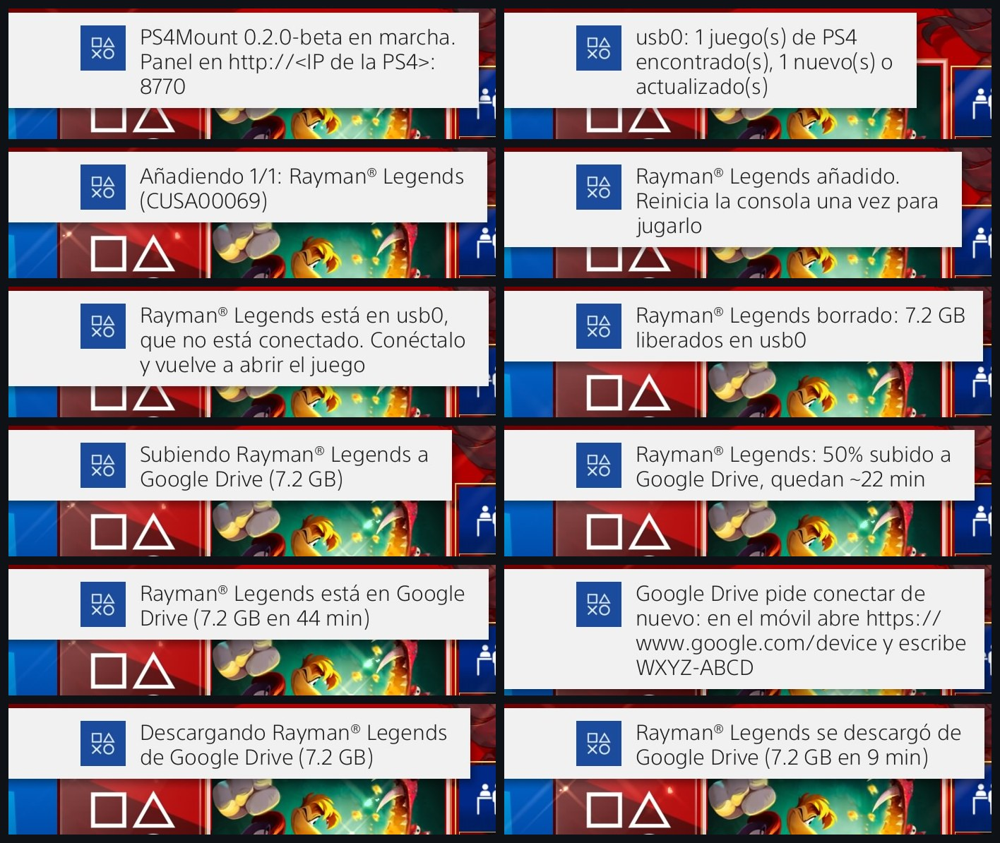

### Por qué hay que reiniciar una vez

La consola solo inicia un juego cuando su servicio de descargas (BGFT) conoce la tarea del juego, y ese servicio solo las lee al arrancar. PS4Mount escribe la tarea al añadir el juego, así que el primer arranque del juego necesita un reinicio. Hemos probado a cerrar la sesión y a terminar una instalación real, y ninguna de las dos lo evita. Los DLC no necesitan reinicio.

### El panel

Abre `http://<IP de la PS4>:8770` en el navegador de un móvil o un PC de la **misma red**. Hay una versión sencilla para navegadores antiguos (`/legacy`), sin probar todavía en el navegador de la propia PS4.

| Estado | Significa |
| --- | --- |
| Listo | En la biblioteca, listo para jugar |
| Reinicia para jugar | Añadido en este arranque: reinicia una vez |
| Abierto | El juego está abierto |
| Añadiéndose | Se está añadiendo |
| Fuera de la biblioteca | Quitado de la biblioteca; sus pkgs siguen en el disco |
| Unidad no conectada | Su disco no está conectado: conéctalo para jugar |
| Instalado en la consola | Hay una instalación normal de ese juego: PS4Mount no lo toca |
| En otra unidad | El mismo juego está en otro disco conectado, que es el que se usa |

Cada juego tiene una ficha (pulsa su portada) con su versión, el firmware que necesita, su tamaño y dónde está.

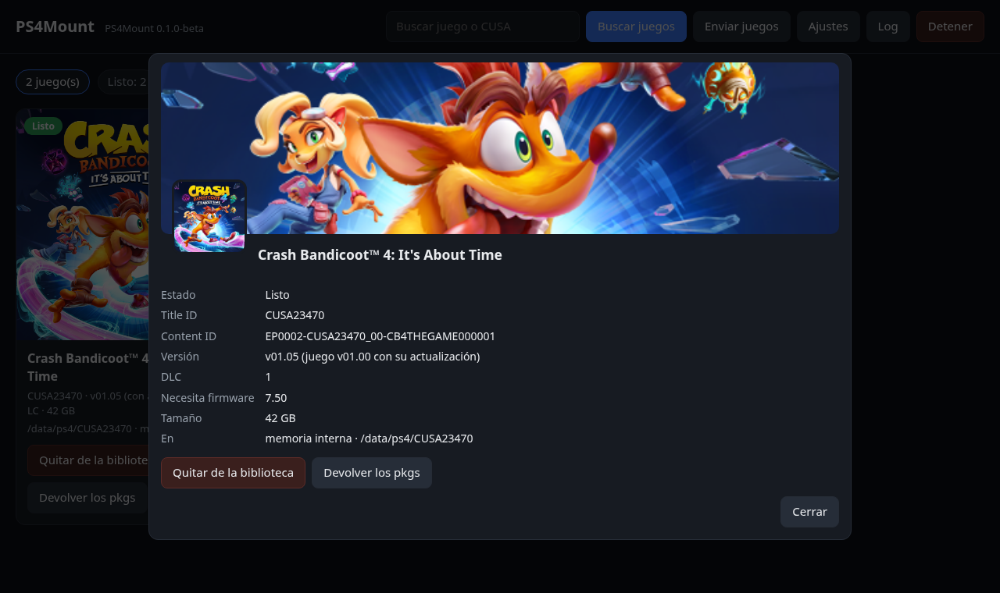

Botones: **Quitar de la biblioteca** (lo quita de la consola y conserva sus pkgs), **Añadir a la biblioteca**, **Buscar juegos**, **Enviar juegos**, **Ajustes**, **Log**, **Detener** y, en la esquina, **Conectar Google Drive** (ver más abajo).

En la ficha del juego también está **Restaurar archivos originales**: deshace lo que PS4Mount hizo con sus archivos. Quita el juego de la consola y vuelve a dejar sus pkgs donde estaban, con el nombre que tenían (por ejemplo, `ps4/CUSA00092/app.pkg` vuelve a ser `PS4Mount/Flower/Flower.pkg`). Sirve para recuperar tus archivos tal como los tenías, por ejemplo para instalar el juego de la forma normal. No borra nada, y PS4Mount no vuelve a tomar esos pkgs.

### Enviar juegos desde el PC

En el panel, **Enviar juegos**: arrastra los pkgs y elige el destino (el USB o la memoria interna).

- Cada pkg se **comprueba antes de enviarse**, en un segundo, con sus primeros 4 MB: si es un pkg de PS4 fake, si es juego, actualización o DLC, si está completo y si cabe. Solo se envían los que la consola puede usar. Un pkg hecho para un firmware más nuevo que el tuyo sí se envía, con un aviso: solo funcionará con un backport.
- Se envían primero los juegos, luego las actualizaciones y al final los DLC.
- Si cortas o falla un envío, no queda ningún archivo a medias, y puedes pulsar **Enviar de nuevo**.
- Al llegar, el juego se añade solo.

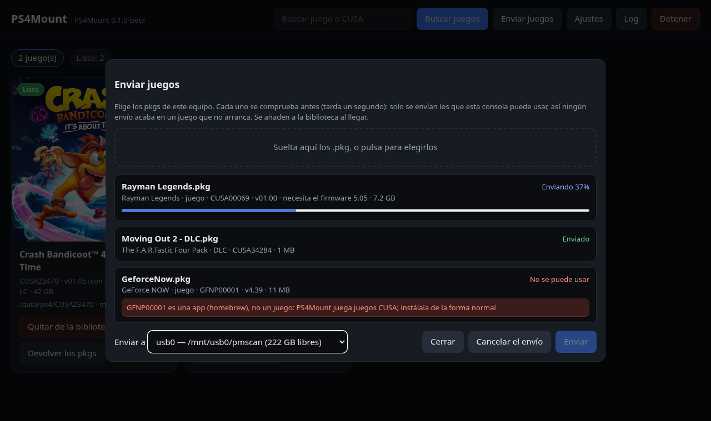

### Descargar desde enlaces

En el panel, **Descargar enlaces**: pega los enlaces, uno por línea, elige dónde guardarlo y pulsa **Descargar**. La consola descarga sola: puedes cerrar el panel o apagar el ordenador.

- Sirve un **pkg**, un **ZIP** o un **RAR**, también en partes (`nombre.part1.rar`, `nombre.part2.rar`… o `nombre.rar`, `nombre.r00`, `nombre.r01`…). Pega todas las partes, en cualquier orden: PS4Mount las junta en una sola descarga y avisa si falta alguna.
- Los enlaces tienen que ser **directos**: los que al abrirlos empiezan la descarga. Una página con un botón de descarga (Mega, MediaFire y parecidas) no sirve, y PS4Mount lo dice. Si el enlace no lleva el nombre del archivo, añade `|` y el nombre: `https://…/descargar?id=123 | juego.pkg`.
- Un RAR o un ZIP **se descomprime mientras baja**, y solo se sacan sus pkgs (el resto, como un .txt o un .nfo, se deja). Las partes se guardan hasta el final, para poder seguir si se corta; si no hay espacio para las partes y los pkgs, cada parte se borra en cuanto se descomprime (y si se corta, empieza de nuevo).
- Con los primeros 4 MB de cada pkg se hace la **misma comprobación** que al enviar desde el PC (si es fake, si está completo…): si no sirve, la descarga se para ahí, sin bajar el resto.
- Baja con varias conexiones a la vez, como Drive, y la consola no entra en reposo mientras descarga. Si se corta la conexión, sigue sola; si cierras PS4Mount, sigue al cargarlo.
- Al terminar, los pkgs quedan en una carpeta con el nombre de la descarga dentro de la carpeta `PS4Mount` del disco, y el juego se añade solo.
- Un RAR (5) con **contraseña**, también en partes y con la lista de archivos cifrada: escríbela en **Contraseña** al añadirlo, o pulsa **Reintentar** y escríbela si la descarga se paró por eso. No hace falta si ya abrió otra descarga (se guardan en `/data/ps4mount/passwords.txt`) ni si es el sitio entre corchetes al principio del nombre (`[SITIO.COM]-juego.part1.rar`: se prueba `[SITIO.COM]`, `SITIO.COM` y `sitio.com`): esas se prueban solas. Una contraseña equivocada se nota con el primer bloque, sin bajar el resto.
- Un ZIP con contraseña también se abre, clásica o AES, igual que un RAR.
- No se puede: un RAR antiguo (RAR4) con contraseña, un **7z**, o un enlace que pide iniciar sesión.

| 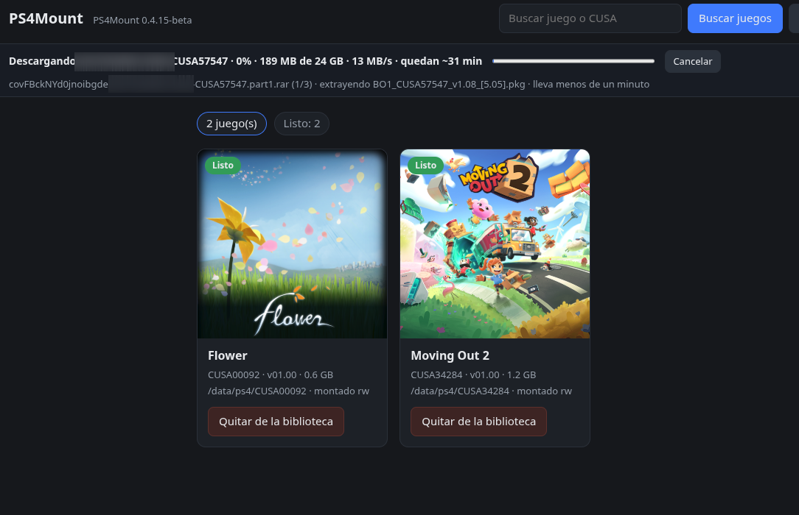 | 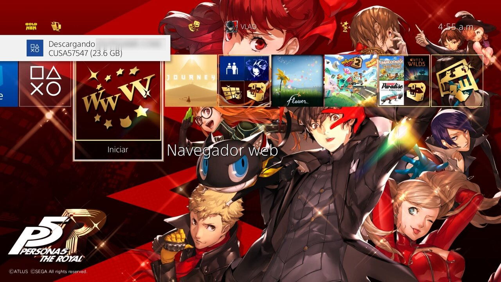 |
|---|---|

### Extensión del navegador

Opcional, para el ordenador: con ella no hace falta buscar el enlace directo. Pulsas **Descargar** en cualquier web, como siempre, y la descarga va a la consola en vez de al ordenador.

- **Cargarla** (todavía no está en las tiendas): descarga `ps4mount-extension.zip` de [Releases](https://github.com/Vld439/PS4Mount-PS4/releases) y descomprímelo. En Chrome, Brave o Edge: `chrome://extensions` → activa **Modo desarrollador** → **Cargar descomprimida** → elige la carpeta. En Firefox: `about:debugging#/runtime/this-firefox` → **Cargar complemento temporal** → el archivo `manifest.json` (se quita al cerrar Firefox).
- Pulsa su icono, escribe la dirección de la consola, pulsa **Conectar** (el navegador pide permiso para llegar a ella) y elige dónde guardar.
- Un **pkg**, un **ZIP** o un **RAR** suelto va a la consola al momento. Las **partes de un RAR** esperan en la **cesta** del icono: descárgalas todas y pulsa **Enviar**, con la contraseña si la tiene. Lo demás (un .exe, un .pdf…) se descarga en el ordenador como siempre.
- Manda la dirección final del archivo (tras las redirecciones) y cancela la descarga en el ordenador, así que también sirve con los enlaces de un solo uso.
- **Experimental:** bajar también a través del navegador. La consola sigue bajando por su cuenta y el navegador le pasa además parte de los bloques, con sus cookies, por la red local (puerto 8771). Solo ayuda con sitios que no limitan cada conexión, y mientras el navegador siga abierto; si lo cierras, la consola sigue sola.
- No hay extensiones en Chrome para Android ni en iPhone: desde el móvil, usa **Descargar enlaces** del panel.

| 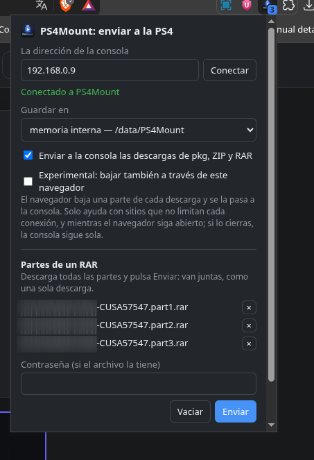 | 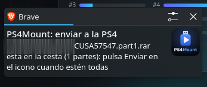 |
|---|---|

### Copias en Google Drive

Opcional. Tus juegos en **tu propio Google Drive**, para liberar espacio o tenerlos a salvo, y para volver a bajarlos a la consola cuando quieras. La consola sube y baja ella sola: no hace falta PC, el panel se puede usar desde el móvil.

- **Copia en Drive** (arriba, una vez conectado): sube toda la biblioteca, cada juego con su actualización y sus DLC. Lo que ya está en Drive se salta.
- **Enviar a Drive**, en la ficha de un juego: sube ese juego.
- **Google Drive** (esquina): tu cuenta, el espacio usado y los juegos que tienes en Drive, cada uno con **Descargar** (eliges la unidad: el USB o la memoria interna) y **Borrar de Drive** (va a la papelera de Drive; lo de la consola no se toca).

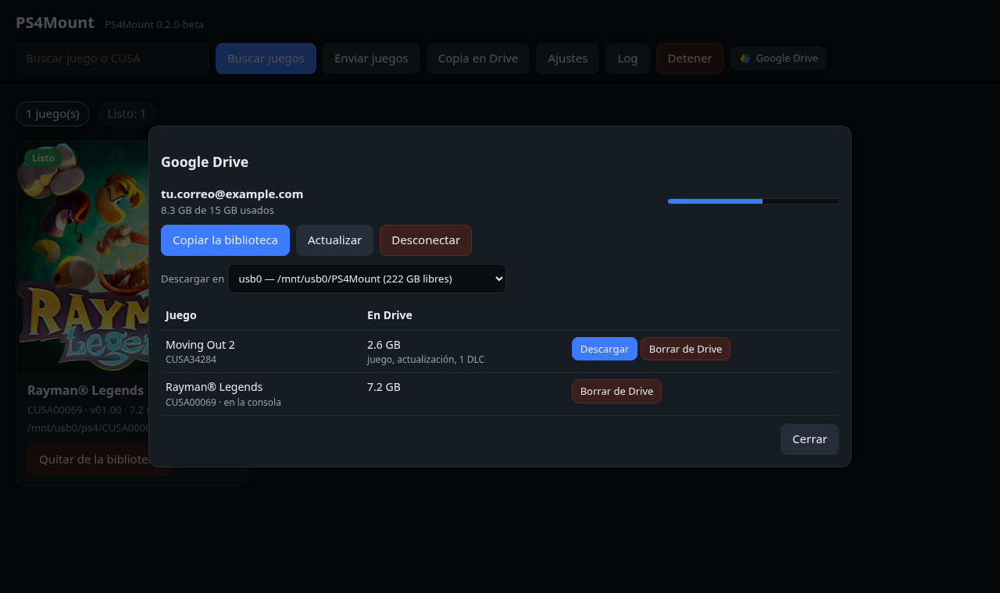

Mientras transfiere, el panel muestra el juego, el porcentaje, la velocidad y el tiempo que queda (la barra de la [primera captura](#español) es una descarga), y la PS4 avisa en pantalla al empezar, al 25, 50 y 75 % y al terminar. **La consola no entra en reposo** mientras haya una transferencia, y puedes jugar o usar el panel a la vez. Si algo la corta (la red, detener PS4Mount, apagar), **sigue sola** desde donde iba la próxima vez que cargues PS4Mount. Cada archivo se comprueba con su MD5 al subir y al bajar: un archivo dañado nunca se da por bueno.

| Subiendo un juego | Su ficha mientras sube |
| --- | --- |
| 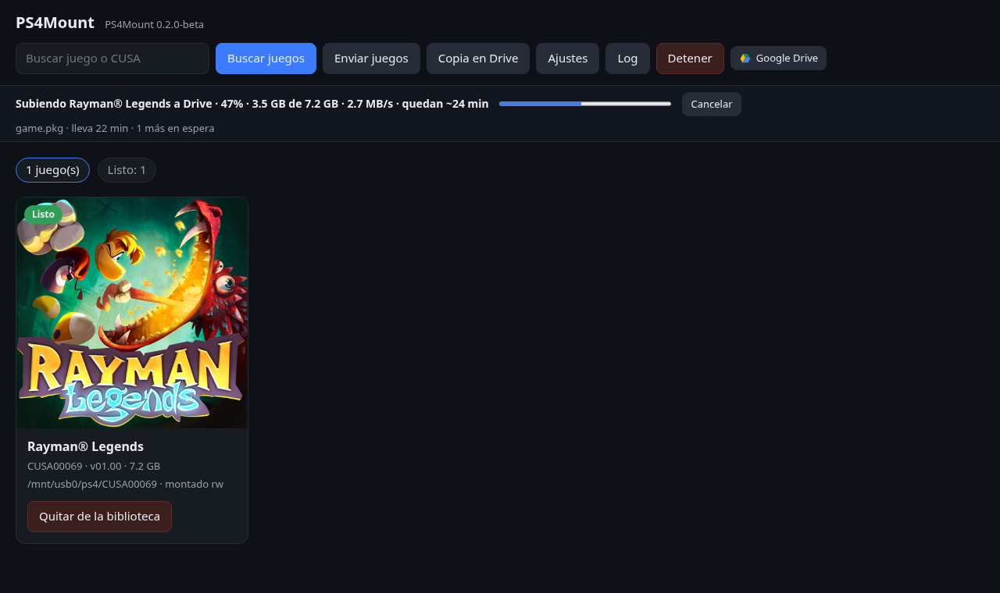 | 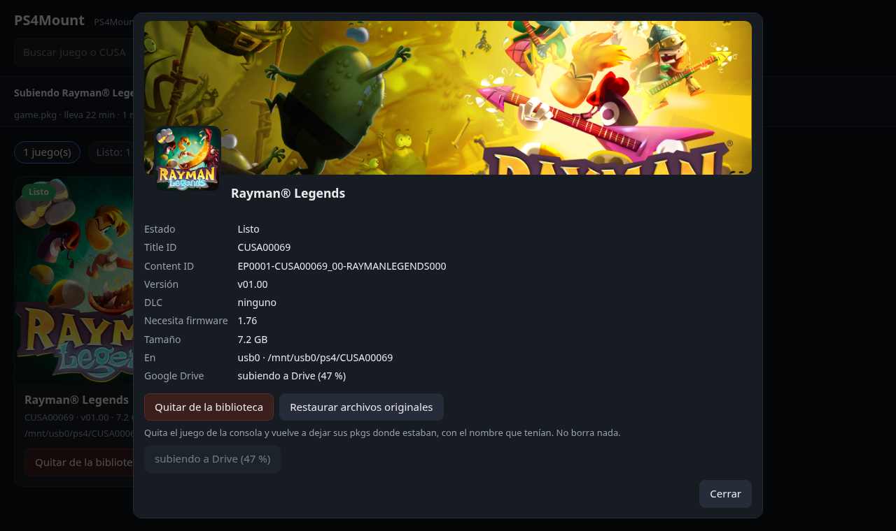 |

Al descargar, el juego llega a `PS4Mount/<Juego> [CUSAxxxxx]/` de la unidad elegida y PS4Mount lo añade solo (con el reinicio de siempre). Un juego que ya está en la biblioteca no se descarga encima.

En Drive quedan en la carpeta `PS4Mount/<Juego> [CUSAxxxxx]/`, como `game.pkg`, `update.pkg` y `addon-….pkg`. PS4Mount usa el permiso `drive.file` de Google: **solo ve los archivos que él crea**, nada más de tu Drive (por eso tampoco ve pkgs que subas a Drive por tu cuenta). Ver [PRIVACY.md](PRIVACY.md).

| | Velocidad medida (PS4 13.52, por cable) |
| --- | --- |
| Subida | La de tu conexión (2,8 MB/s en una línea de 2,8 MB/s: 7,2 GB en 45 min) |
| Bajada | ~15 MB/s, el máximo de la PS4 (12 conexiones a la vez): 60 GB en ~1 h 10 min |

#### Conectar tu Google Drive (una vez)

PS4Mount no trae credenciales de Google: cada usuario usa **las suyas**, que se quedan solo en su consola. Se crean gratis en unos minutos:

1. Abre **[console.cloud.google.com](https://console.cloud.google.com/)** con tu cuenta de Google, pulsa el selector de proyectos (arriba a la izquierda) → **Proyecto nuevo**, nombre **PS4Mount** → **Crear**. Comprueba que arriba está elegido PS4Mount.

   <details><summary>Ver captura</summary>

   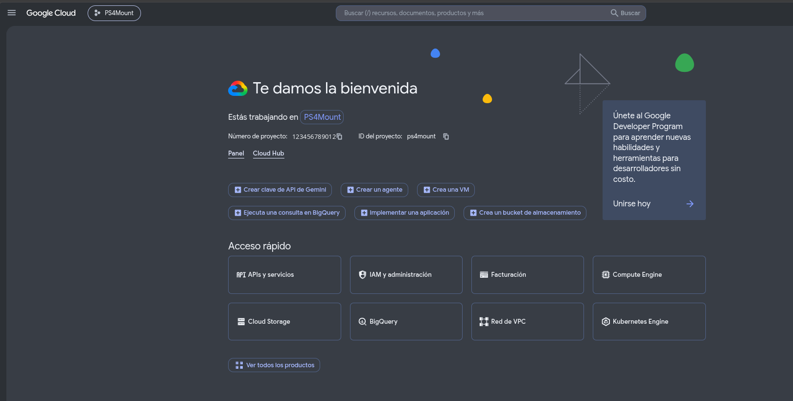

   </details>
2. En el buscador de arriba escribe **Google Drive API** → **Habilitar** (si ya lo está, dice "API habilitada" y el botón es **Administrar**).

   <details><summary>Ver capturas</summary>

   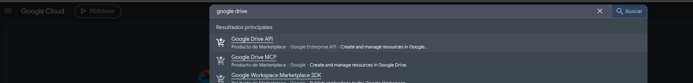

   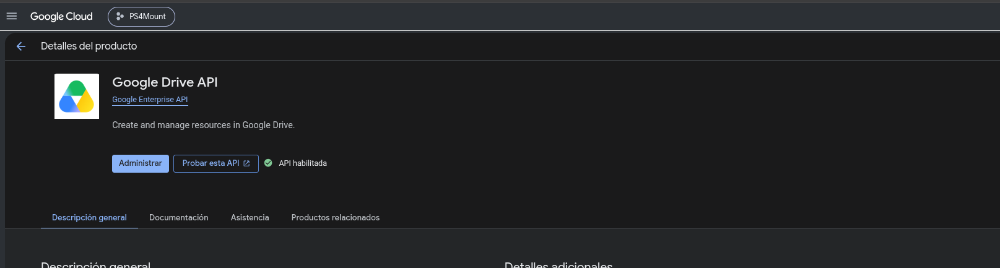

   </details>
3. Menú ☰ → **APIs y servicios** → **Pantalla de consentimiento de OAuth** (Google Auth Platform) → **Comenzar**: nombre de la app **PS4Mount**, tu correo, público **Externo**, tu correo de contacto, acepta la política → **Crear**. No subas logo (con logo, Google pide verificar la app).

   <details><summary>Ver capturas</summary>

   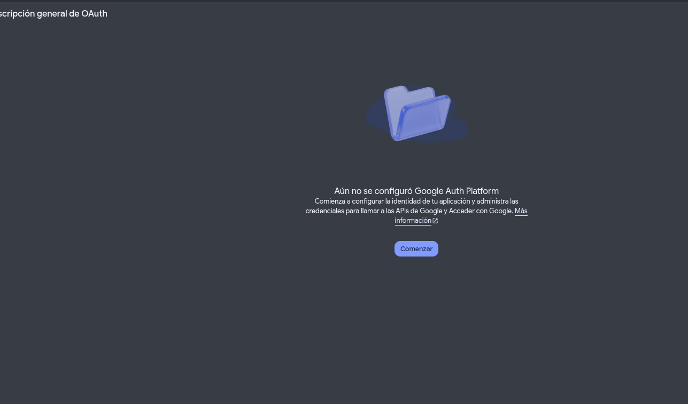

   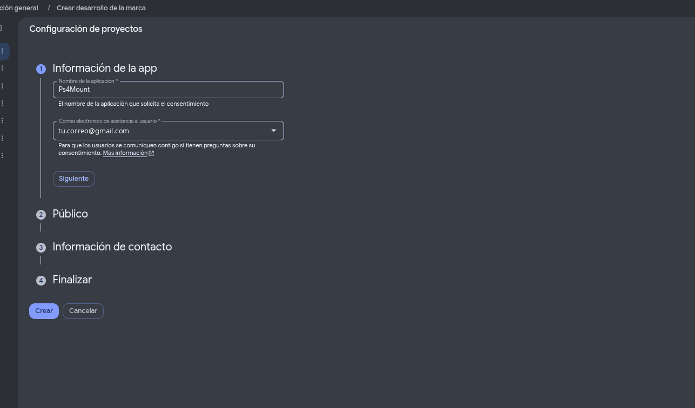

   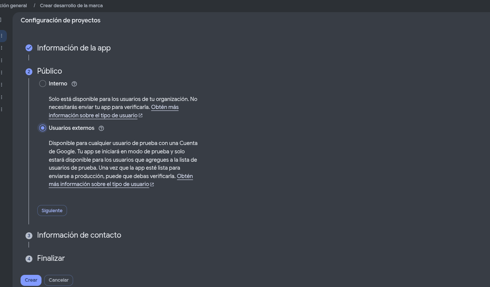

   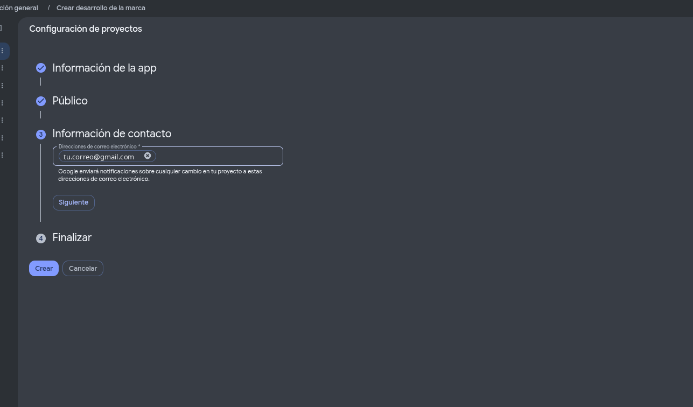

   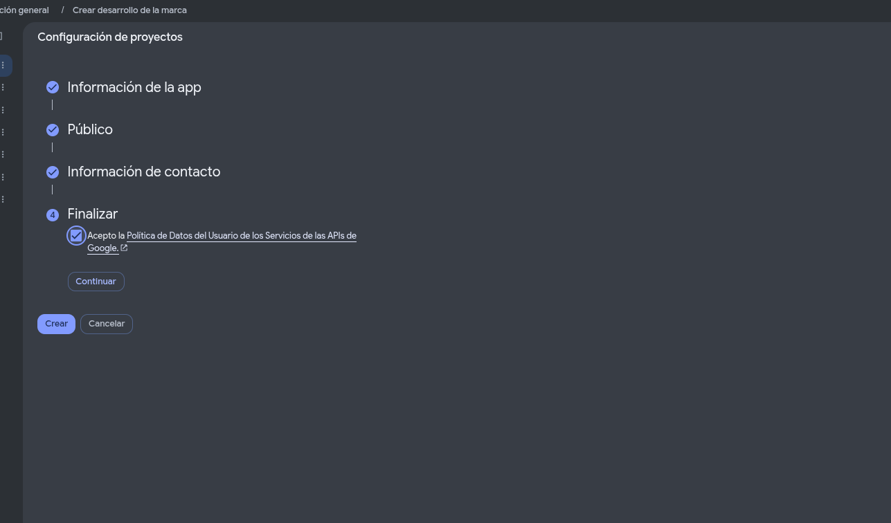

   </details>
4. **Clientes** → **Crear cliente** → tipo **TV y dispositivos de entrada limitada** (no "App de escritorio" ni "Aplicación web": con esos la consola no puede iniciar sesión) → nombre **PS4Mount consola** → **Crear**. Copia el **ID de cliente** (termina en `.apps.googleusercontent.com`) y el **Secreto del cliente** (descarga el JSON: el secreto puede no volver a mostrarse).

   <details><summary>Ver capturas</summary>

   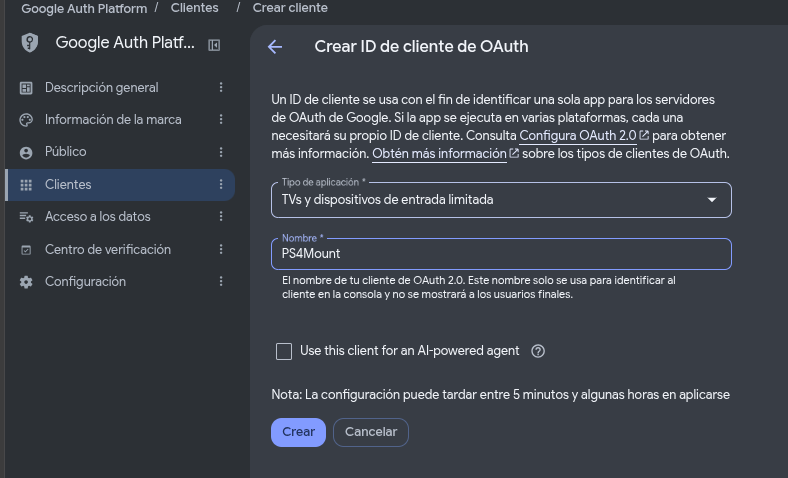

   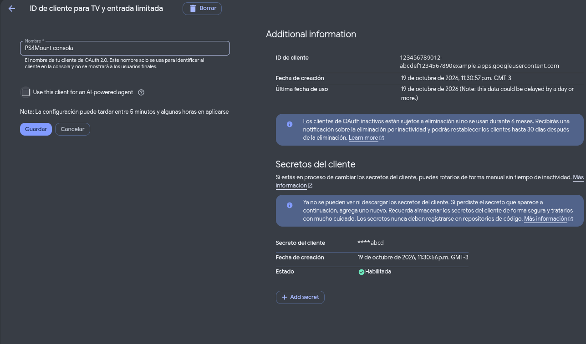

   </details>
5. **Público** → **Usuarios de prueba** → **Add users** → tu correo de Google → **Guardar**. (La app se queda en estado "Prueba": no hace falta publicarla ni la sección de marca.)

   <details><summary>Ver captura</summary>

   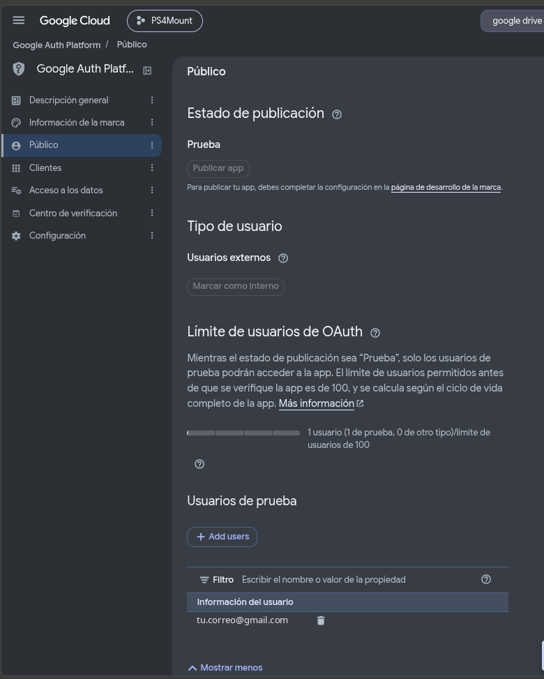

   </details>
6. *(Opcional)* **Acceso a los datos** → **Agregar o quitar permisos** → marca `…/auth/drive.file` → **Actualizar** → **Save** (abajo; sale en inglés).

   <details><summary>Ver capturas</summary>

   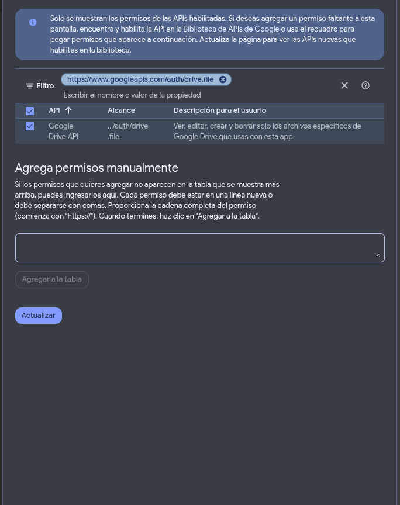

   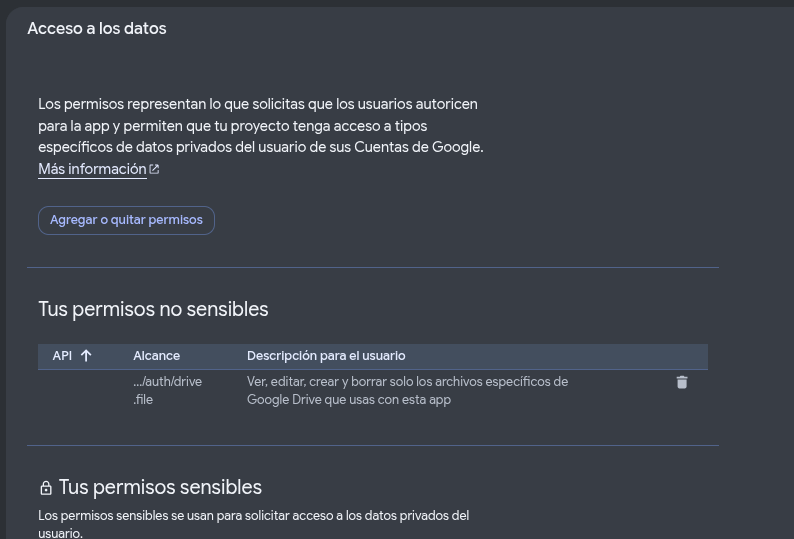

   </details>
7. En el panel de PS4Mount: **Conectar Google Drive** → pega el ID y el secreto → **Guardar** → **Conectar**. Sale un código: en el móvil o el PC abre **google.com/device**, escríbelo con la cuenta de prueba y acepta. Google avisa de que la app no está verificada: es tu propia app, pulsa **Continuar**.

| Pegar tu cliente | El código para google.com/device |
| --- | --- |
| 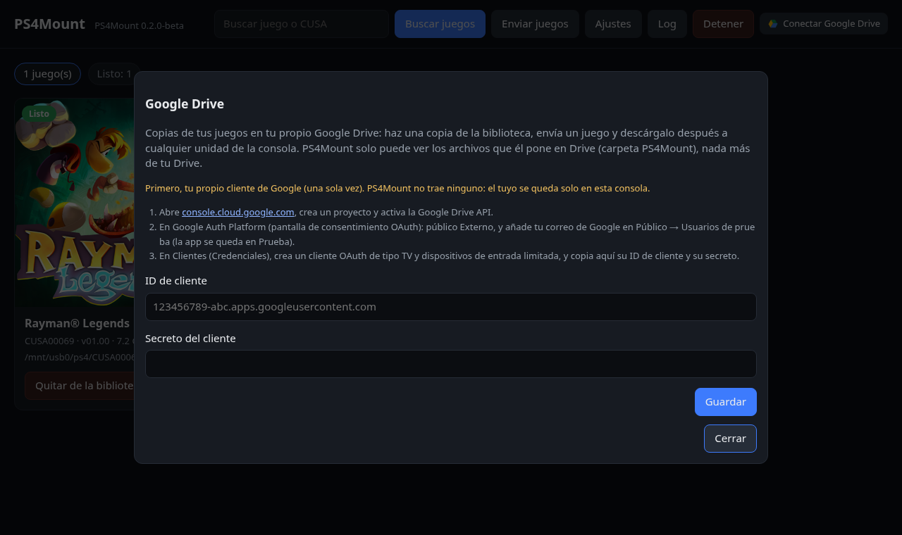 | 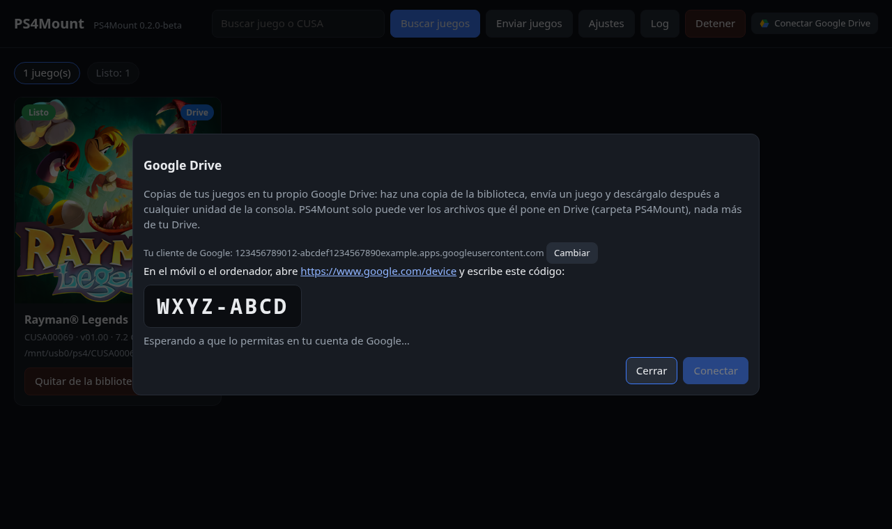 |

En google.com/device (en el móvil o el PC):

| 1. Escribe el código | 2. "Google no verificó esta app": **Continuar** |
| --- | --- |
| 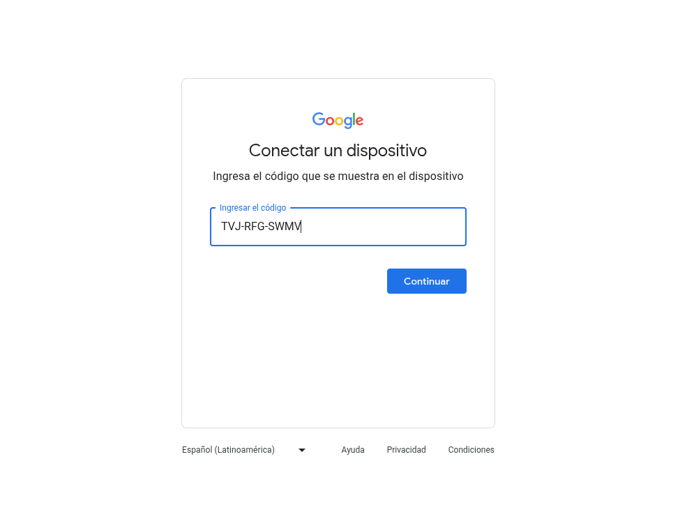 | 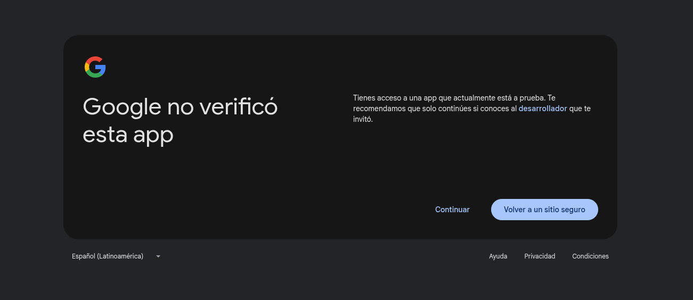 |
| **3. El permiso: solo los archivos que crea PS4Mount → Continuar** | **4. Listo: vuelve al panel** |
| 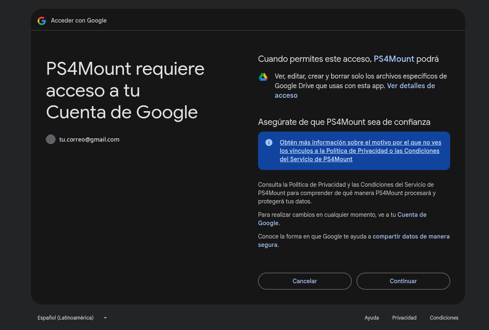 | 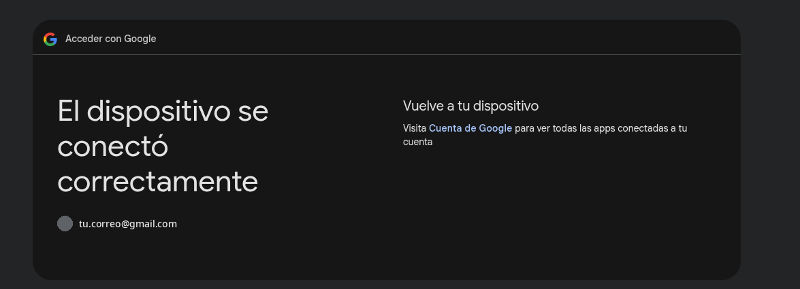 |

Ya está: el panel muestra tu correo y tu espacio. La conexión se guarda en la consola y sobrevive a los reinicios. Google puede pedir a las apps en estado "Prueba" que vuelvan a conectarse pasado un tiempo: si pasa, PS4Mount muestra **en la pantalla de la PS4** un código nuevo para escribir en google.com/device, y lo que estaba transfiriendo sigue después. **Desconectar** (en la ventana de Google Drive) quita el acceso en Google y lo borra de la consola; también puedes quitarlo desde tu cuenta de Google (Seguridad → Conexiones de terceros).

### Ajustes

| Ajuste | Por defecto | Significa |
| --- | --- | --- |
| Carpetas donde buscar pkgs | `/PS4Mount` | Solo se usa con **Organizar** activado: carpetas de cada disco donde se buscan pkgs nuevos, una por línea (`/` es la raíz: todos los pkgs de juegos de la raíz se moverían a `ps4/`). Se miran hasta dos niveles de subcarpetas. `ps4` no se puede usar. Apagado (por defecto), se busca en toda la unidad, sin renombrar ni mover nada. |
| Añadir los juegos nuevos por grupos / Juegos por grupo | Sí / 5 | Añade muchos juegos por grupos, para no saturar la consola. |
| Instalar DLC | Sí | Instala los DLC (ver arriba). |
| Instalar también los DLC grandes | Sí | Los DLC de más de 256 MB también se instalan, en segundo plano: un juego solo ve un DLC instalado por el sistema. Ocupan memoria interna; antes se comprueba que haya sitio. Apagado, no se usan. |
| Organizar los pkgs en la carpeta ps4 | No | Mueve los pkgs a `ps4/<TITLE_ID>/` para tenerlos ordenados. Apagado (por defecto), los pkgs se usan donde están, con su nombre, sin mover ni renombrar nada; los que PS4Mount ya había organizado vuelven solos a su sitio original (los organizados a mano se quedan en `ps4/`). En la memoria interna se buscan solo `/data/PS4Mount` y `ps4`. |
| Usar también los pkgs de /data/PS4Mount | Sí | Usa también los pkgs de la memoria interna. |
| NAS (NFS o SMB) | No | Usa los pkgs de una carpeta compartida en red, **solo lectura** y sin mover ni renombrar nada (con Organizar activado no aparece). Solo firmware 13.52 (ver abajo). |
| Idioma | El de la consola | El idioma del panel y de las notificaciones: el de la consola, inglés o español. |

Se guardan en `/data/ps4mount/config.txt`. Los ajustes también tienen **Restaurar los archivos de todos los juegos** (o de los elegidos) y **Volver a usar los pkgs restaurados**.

### Juegos desde una NAS (SMB o NFS)

Los juegos de una **carpeta compartida en la red** (un PC con Windows, Linux o macOS, o una caja NAS como Synology, QNAP o un router con USB) se juegan **desde ahí**, con su actualización y sus DLC, **sin copiarlos ni instalarlos** en la consola. Es **solo lectura**: PS4Mount nunca escribe, renombra ni mueve nada en el recurso. Solo firmware **13.52**.

**1. Comparte la carpeta de los juegos** en el ordenador o el NAS:

| Equipo | Cómo |
| --- | --- |
| **Windows** | Clic derecho en la carpeta → Propiedades → Compartir → Uso compartido avanzado → marca **Compartir esta carpeta**. Windows pide cuenta: en el panel pondrás tu usuario y contraseña de Windows. Si la consola no encuentra el PC, pon su red como **Privada**. |
| **macOS** | Ajustes del Sistema → General → Compartir → activa **Compartir archivos** y añade la carpeta. En Opciones, activa compartir por SMB para tu usuario. |
| **Linux** | Comparte la carpeta con **Samba** (solo lectura, invitado permitido) o **NFS** (`/etc/exports`), y deja pasar la dirección de la consola en el cortafuegos. |
| **Caja NAS** | Activa compartir archivos por **SMB** (o NFS) en sus ajustes y da permiso de lectura a la carpeta. |

**2. En el panel**, en **Ajustes → NAS**, pulsa **Buscar servidores en la red**. La consola prueba toda su red en unos segundos y lista los equipos que comparten archivos. Elige uno y aparecen sus **carpetas compartidas**: elige la de los juegos y pulsa **Guardar**. Si el servidor pide cuenta, el panel lo dice: pon **Usuario** y **Contraseña** y pulsa **Ver los recursos del servidor**.

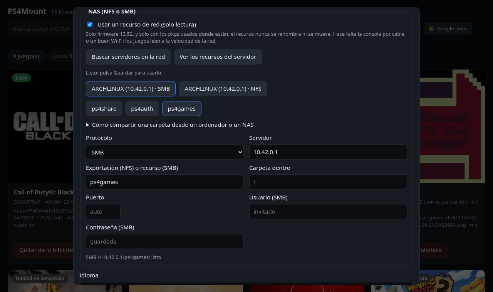

Los juegos aparecen en la biblioteca como los de un USB (la primera vez, reinicia la consola una vez). En su ficha, **En** dice **NAS**:

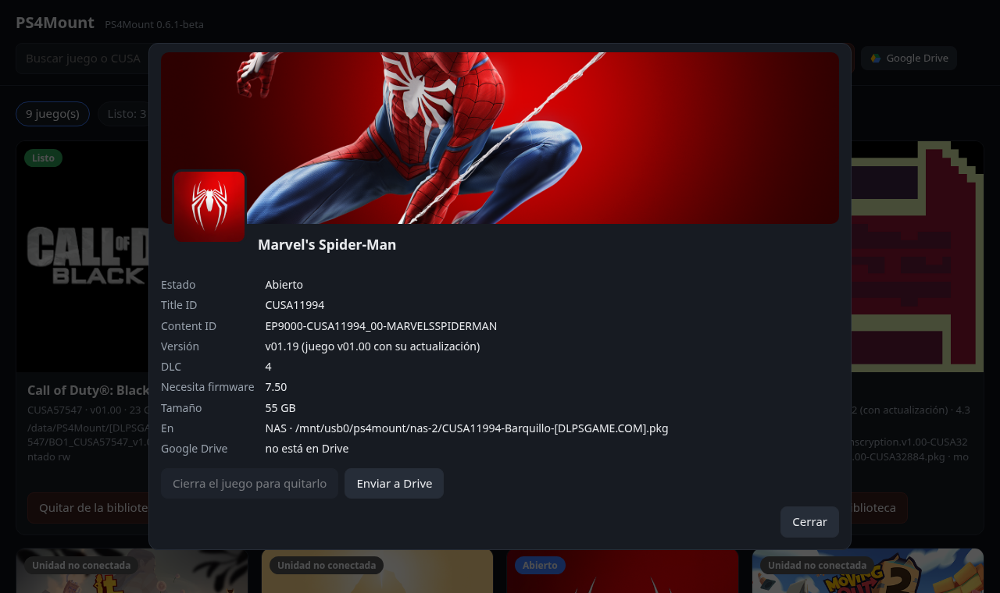

Los campos se pueden rellenar también a mano:

| Campo | Qué poner |
| --- | --- |
| Protocolo | **SMB** (Windows, macOS, la mayoría de NAS) o **NFS** (Linux, NAS). |
| Servidor | La IP del ordenador o del NAS (`192.168.0.19`). |
| Exportación (NFS) o recurso (SMB) | En SMB, el nombre del recurso (`games`). En NFS, la ruta exportada (`/volume1/games`). |
| Carpeta dentro | Opcional: una subcarpeta, para no recorrer todo el recurso. |
| Puerto | Opcional: se deja vacío (445 en SMB, 2049 en NFS). |
| Usuario y contraseña (SMB) | Vacíos, entra como invitado. La contraseña se guarda en claro en `config.txt`. |

- **Mejor por cable.** PS4Mount pide los datos por adelantado y varios a la vez, así que aprovecha casi toda la red, pero por Wi-Fi las cargas son lentas y alguna textura tarda en aparecer. **Con cable** se juega como desde el disco interno. Si no tienes switch ni un puerto libre en el router, sirve un **cable directo del PC a la consola**: en el PC, comparte su conexión por ese cable (en Linux con NetworkManager: `nmcli connection add type ethernet ifname <interfaz> con-name ps4 ipv4.method shared`; en Windows, "Conexión compartida a Internet" del adaptador Wi-Fi), y en la PS4 configura la red por cable en modo **Fácil**.
- **Solo firmware 13.52**: en otros el ajuste sale desactivado (la consola no trae NFS y el sistema de ficheros en modo usuario, FUSE, no se puede activar).
- **Solo con Organizar apagado** (el valor por defecto): el recurso nunca se organiza.
- **SMB** usa SMB2/3. **NFS** prueba NFSv4.2, NFSv4.0 y NFSv3; para que el panel liste las exportaciones, el servidor tiene que tener `rpcbind` (si no, escríbela a mano).
- Un servidor que **no contesta** (apagado, dirección mal escrita, cortafuegos) se avisa en 3 segundos.
- **Si se corta la red** en plena partida (un cable desenchufado, el PC reiniciado), el juego se queda en pausa y sigue solo cuando vuelve: PS4Mount reconecta y reabre los ficheros. Espera hasta 2 minutos; pasado ese tiempo el juego recibe el error y puede fallar.
- **Cambiar** de protocolo, servidor o carpeta no necesita reiniciar: se reconecta al momento.
- El recurso se monta en `/mnt/usb0/ps4mount/nas-<n>`, una ruta que el instalador del sistema acepta. **No hace falta un USB conectado.**
- **BinLoader tiene que estar encendido** en el menú de GoldHEN: si PS4Mount arranca solo con la consola (AutoRun), ese proceso no puede abrir los dispositivos FUSE (una limitación de GoldHEN), así que PS4Mount se vuelve a cargar solo por BinLoader (puerto 9090), en unos segundos y sin avisos de más. Con BinLoader apagado, los juegos de USB y de la memoria interna funcionan igual, pero la NAS no se monta.
- **Volver a cargar PS4Mount en el mismo arranque** monta el recurso en otra carpeta (`nas-2`, `nas-3`…), y los juegos del NAS piden reiniciar una vez. Tras unas pocas cargas en el mismo arranque se acaban los dispositivos FUSE: reinicia la consola.
- Al **borrar un juego desde la consola**, los pkgs del recurso no se borran (son tuyos): el juego sale de la biblioteca y los ficheros siguen en el NAS.

### Quitar y borrar juegos

- **Borrar desde la consola** (Options → Eliminar, o Ajustes → Almacenamiento): borra el juego **y sus pkgs** (juego, actualización y DLC), y libera el espacio, como con un juego instalado. Solo cuando confirmas el borrado en esas pantallas, y solo la carpeta de ese juego.
- **Quitar de la biblioteca** en el panel: quita el juego de la consola y **conserva sus pkgs**, para volver a añadirlo con **Añadir a la biblioteca**.

Mientras están abiertas las pantallas de borrado, PS4Mount desmonta las carpetas de los juegos, así que el borrado del sistema nunca llega a los pkgs: los borra PS4Mount, y solo la carpeta de ese juego.

Con "Organizar" apagado, **borrar desde la consola no borra tus pkgs**: el juego sale de la biblioteca y queda marcado como quitado, y los `.pkg` siguen donde estaban (son tuyos). **Restaurar los archivos originales** no aplica en ese modo.

### Bueno saber

- **Carga PS4Mount después de cada arranque.** Sin él, los juegos no pueden iniciarse (siguen en la pantalla de inicio).
- **Cierra los juegos de PS4Mount antes de poner la consola en reposo**: el reposo apaga el USB.
- Si **desconectas el USB**, sus juegos se quedan en la pantalla de inicio y el panel los muestra como *Unidad no conectada*. Al reconectarlo, espera la notificación `usb0: … encontrado(s)` antes de abrirlos.
- Si GoldHEN carga PS4Mount automáticamente y luego lo cargas tú, verás `PS4Mount … ya está en marcha`: es normal, el segundo se cierra solo.
- El panel no tiene contraseña: cualquiera en tu red local puede abrirlo. No expongas el puerto 8770 a Internet.

### Problemas frecuentes

| Problema | Qué hacer |
| --- | --- |
| CE-32930-7 al abrir un juego recién añadido | Reinicia la consola una vez y vuelve a cargar PS4Mount. |
| "No se puede iniciar la aplicación" | Comprueba que PS4Mount está en marcha y que el disco del juego está conectado (PS4Mount avisa si no lo está). |
| El panel no abre | Usa la IP de la **consola**, con `http://` delante y `:8770`, desde la misma red. |
| Un pkg no se añade | Mira el log (panel → **Log**): dice por qué (no es fake, necesita otro firmware, está incompleto…). |
| El panel o las notificaciones salen en otro idioma | Cámbialo en **Ajustes → Idioma**. |
| Google Drive: `invalid_client` al conectar | El cliente no es del tipo **TV y dispositivos de entrada limitada**, o el ID/secreto están mal copiados: crea uno de ese tipo y pégalo de nuevo. |
| Google Drive: "acceso bloqueado" o "access_denied" | Añade tu correo en **Público → Usuarios de prueba** del proyecto. |
| Google Drive: la descarga dice "llegó dañado" | PS4Mount ya lo ha intentado dos veces desde cero; vuelve a pulsar Descargar más tarde. |
| Enlaces: "el enlace abre una página web" | No es el enlace directo: en la página de descarga, copia el enlace del botón que empieza la descarga (o el que da tu navegador en Descargas). |
| Enlaces: "el servidor rechazó el enlace (403)" | Muchos enlaces caducan o son para un solo navegador: genera uno nuevo y pulsa **Reintentar** o pégalo de nuevo. |
| Un juego falla o pierde partidas también instalado de forma normal | Es el pkg (o su backport), no PS4Mount: prueba otro dump. |

Para informar de un problema, abre un [issue](https://github.com/Vld439/PS4Mount-PS4/issues) con la versión de PS4Mount, el firmware, el juego (`CUSA…`), qué pasó y el log (panel → **Log**, o `/data/ps4mount/log.txt` por FTP). No adjuntes pkgs ni enlaces a ellos.

### Ficheros en la consola

| Fichero | Para qué |
| --- | --- |
| `/data/ps4mount/log.txt` | El log |
| `/data/ps4mount/config.txt` | Los ajustes |
| `/data/ps4mount/stop` | Vacío: para PS4Mount |
| `/data/ps4mount/klog_all` | Vacío: copia todo el log del sistema en el log de PS4Mount (diagnóstico) |
| `/data/ps4mount/drive_client.txt` | Tu ID de cliente y secreto de Google |
| `/data/ps4mount/drive.txt` | La conexión con tu cuenta de Google |
| `/data/ps4mount/drive_queue.txt`, `drive_upload.txt` | Las transferencias de Drive a medias (para seguir con ellas) |
| `<carpeta de búsqueda>/.ps4mount-drive/` | Descargas de Drive a medias |
| `/data/ps4mount/links_queue.txt` | Las descargas de enlaces pendientes (con sus enlaces y la contraseña escrita) |
| `/data/ps4mount/passwords.txt` | Las contraseñas que abrieron un archivo comprimido, para probarlas en los siguientes |
| `/mnt/usb0/ps4mount/nas-<n>` | Donde se monta el recurso de red, dentro de la unidad USB (su nombre se guarda en `/data/ps4mount/nas-mnt`) |
| `<carpeta de búsqueda>/.ps4mount-links/` | Descargas de enlaces a medias |
| `/system_data/ps4mount/` | Las carpetas internas de los juegos |

## Compilar

```
bash test/run.sh        # tests en el ordenador (SANITIZE=1 para ASan/UBSan)
bash test/policy.sh     # reglas del proyecto
cd test/web && npm test # el panel
PS4_PAYLOAD_SDK=/ruta/al/sdk bash build.sh   # build/ps4mount-ps4.elf y .bin
```

Necesitas el [ps4-payload-sdk](https://github.com/ps4-payload-dev/sdk) **compilado desde git**: la release v0.9 no arranca en 13.52 (su runtime solo conoce hasta 13.50). La CI usa el commit indicado en `SDK_COMMIT` de `.github/workflows/build.yml`. [AI-WORKFLOW.md](AI-WORKFLOW.md) explica cómo trabajar en PS4Mount con un asistente de IA.

## Créditos

- **[PS4Mount](https://github.com/gasb07/ps4mount)**, de **gasb07**: el proyecto del que nace este port (la lectura de pkgs, los ficheros de instalación, el montaje, el panel). Su historial está en el proyecto original y en el historial de git de este repositorio.
- **[LibOrbisPkg](https://github.com/maxton/LibOrbisPkg)** (maxton, LGPL-3.0): la clave de los pkgs fake (`src/keys.h`) y la referencia del formato.
- **[ps4-payload-sdk](https://github.com/ps4-payload-dev/sdk)** (John Törnblom, GPL-3.0-or-later): el toolchain y el runtime del payload.
- **flatz**: la interfaz de BGFT documentada en [ps4_stub_lib_maker_v2](https://github.com/flatz/ps4_stub_lib_maker_v2), y **[ps4-ipi](https://github.com/0x199/ps4-ipi)** como referencia de su uso, para instalar los DLC.
- **[SQLite](https://sqlite.org)** (dominio público): la lectura de la base de datos de la consola.
- **[BearSSL](https://bearssl.org)** (Thomas Pornin, MIT): el TLS con el que la consola habla con Google Drive y con las webs de los enlaces.
- **[libarchive](https://www.libarchive.org)** (BSD-2-Clause) y **[zlib](https://zlib.net)** (licencia zlib): la lectura de los RAR y ZIP mientras se descargan.
- La **lista de autoridades de certificación de Mozilla** (MPL-2.0): las raíces en las que confía la consola para los enlaces.
- **[ShadowMountPlus](https://github.com/drakmor/ShadowMountPlus)** (drakmor): inspiración del original para montar juegos desde USB.
- **[libsmb2](https://github.com/sahlberg/libsmb2)** y **[libnfs](https://github.com/sahlberg/libnfs)** (Ronnie Sahlberg, LGPL-2.1): los clientes SMB y NFS de la NAS.
- **[libfuse](https://github.com/libfuse/libfuse)** 2.9 (LGPL-2.1) con el port a PS4 de **[Itemzflow](https://github.com/LightningMods/Itemzflow)** (LightningMods, GPL-3.0): el sistema de ficheros en modo usuario y el parche de 13.52 que activa fusefs.

## Licencia

GPL-3.0-or-later (ver [LICENSE](LICENSE)). Si publicas tu propia versión, conserva los avisos, distribuye los cambios con la misma licencia y, por favor, menciona a gasb07 y enlaza el proyecto original.

---

<a name="english"></a>
# English

PS4Mount is a payload for a jailbroken PS4. Put the game pkgs (with their update and add-ons) on a USB drive or in the console's storage, and PS4Mount adds them to the home screen so they are played **from the pkg, without installing them**: no install to wait for, no space spent on a second copy.

It also has a **web panel** (from a phone or a computer) with your library, artwork and a page per game, **sending games from a computer over the local network** (every pkg is checked before it is sent, so no one spends hours sending a game the console cannot use) and **backups in your Google Drive**: the console uploads your games to your Drive and downloads them back, no computer needed. There is a simpler panel page for older browsers, not yet tested on the PS4's own browser.

Tested on a PS4 on firmware **13.52** with GoldHEN. The panel and the notifications are in **English and Spanish**: they follow the console's language (English for any other), and **Settings → Language** changes it.

> [!WARNING]
> **Beta version.** Back up your saved data before using it, and [tell us about any problem](#troubleshooting) with the log.

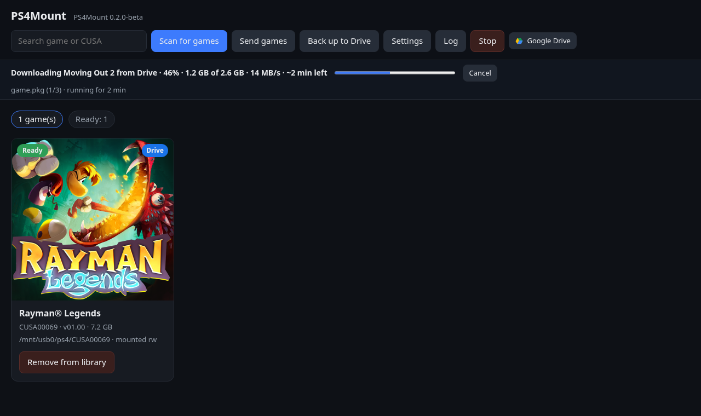

## What works and what does not

| | State |
| --- | --- |
| Games from an **exFAT USB drive** (pkgs over 4 GB too) | ✅ tested |
| Games from the **console's storage** (`/data/PS4Mount`) | ✅ tested |
| Games from a **NAS** over **SMB or NFS**, read only, found on the network | ✅ tested (firmware 13.52 only) |
| **Updates** | ✅ tested |
| Games **where they are**, without moving or renaming their pkgs (any folder of the drive) | ✅ tested |
| **Add-ons (DLC)** up to 256 MB (almost all: costumes, packs, licenses) | ✅ tested: PS4Mount installs them with the system's installer in seconds, and they show in the game's information |
| Add-ons over 256 MB | ✅ tested: installed on their own with the system's installer, in the background (they take internal space; can be turned off in Settings) |
| **Sending games from a computer** over the network, checked first | ✅ tested (about 16 MB/s over a cable) |
| **Deleting** a game on the console | ✅ tested: its pkgs are deleted too and the space is freed |
| **Google Drive backups**: uploading games and downloading them back from the console | ✅ tested: uploads go at your line's speed, downloads at about 15 MB/s (the PS4's most) |
| **Downloading from links**: a pkg, a ZIP or a RAR (also in parts and with a password), downloaded and extracted by the console itself | ✅ tested on the console (a 24.6 GB game in a RAR with a password, in 3 parts) |
| **Browser extension**: pkg, ZIP and RAR downloads go to the console | ✅ tested in Brave; Firefox not tested |
| A **new** game, or an update that arrives after its game | ⚠️ needs **one console restart**; it plays every time after that |
| Other firmwares | ⚠️ not tested yet |
| **Retail** (not fake) pkgs | ❌ |
| **Homebrew ports** (games without a CUSA ID, such as SMW or SSBU: `SMWR00001`, `SSBU00001`) | ✅ tested: played from the pkg like a game, when they weigh **1 GB or more** |
| Homebrew apps (stores, emulators…) under 1 GB | ✅ tested: not played from the pkg, but **Send games** sends them and installs them on the console |

## Requirements

- A jailbroken PS4 with **GoldHEN** (its BinLoader on, port 9090).
- **Payload Guest** or another way to load payloads.
- PS4 **fake** pkgs (`CUSA…`).
- To play from USB: a drive formatted as **exFAT**.

## Use

1. **Download** `ps4mount-ps4.bin` from [Releases](https://github.com/Vld439/PS4Mount-PS4/releases) and copy it to **`/data/payloads/`** on the console (over FTP, or however you copy your other payloads).
2. **After every boot**, open **Payload Guest** and pick PS4Mount. The notification `PS4Mount 0.2.0-beta running. Panel at http://<PS4 IP>:8770` shows up.
3. **Add games**, one of these ways:
   - **On a USB drive:** copy the pkgs **anywhere on the drive** (for example the `PS4Mount` folder, or one folder per game) and plug it into the PS4. PS4Mount searches the whole drive and groups them by the title they carry inside (game, update and add-ons), without moving or renaming them; hidden and system folders are skipped.
   - **From a computer:** with **Send games** in the panel (see below).
   - **In the console's storage:** pkgs in `/data/PS4Mount` (over FTP or with Send games). `/data/pkg` stays the usual installer's: PS4Mount leaves it alone.
4. Wait for the notifications: `usb0: 1 PS4 game(s) found, 1 new or updated` → `Adding 1/1: <game>` → `<game> added. Restart the console once to play it`.
5. **Restart the console once**, load PS4Mount again and play from the home screen.

With **Organize pkgs into the ps4 folder** on (it is off by default), PS4Mount keeps the pkgs it uses in a folder per game on the same drive (a rename, nothing is copied):

```
ps4/CUSAxxxxx/app.pkg                           game
ps4/CUSAxxxxx/patch.pkg                         update
ps4/CUSAxxxxx/addcont/CUSAyyyyy/<LABEL>/ac.pkg  add-on
```

If you turn it on, keep this layout. To add more games, put them where they are searched.

With **Organize pkgs into the ps4 folder** off (in the settings, and the default), PS4Mount moves and renames nothing: it uses the `.pkg` files **where they are**, in any folder of the drive (the ones already in `ps4/` too), grouping them by the title they carry inside (game, update and add-ons). **Merged base+update pkgs** work: a separate update older than the game is not used.

Turning it off sends the games PS4Mount **had organized** back to where they were, with their original names (it remembers them in each game's `origin.txt`), and they are used from there; games you organized by hand stay where they are. The first time, restart the console once, as when adding a game.

### On the console

The game shows on the home screen like any other, and PS4Mount tells you everything with notifications: when it loads, when it finds and adds games, when a game's drive is missing, when one is deleted, and about the Google Drive backups (this console is in Spanish; they follow the console's language).


### Why one restart

The console only starts a game when its background transfer service (BGFT) knows the game's task, and the service reads its tasks at boot only. PS4Mount writes the task when it adds the game, so the game's first start needs a restart. Logging out and finishing a real install were both tried: neither avoids it. Add-ons need no restart.

### The panel

Open `http://<PS4 IP>:8770` in the browser of a phone or computer on the **same network**. There is a simpler page for older browsers (`/legacy`), not yet tested on the PS4's own browser.

| State | Meaning |
| --- | --- |
| Ready | In the library, ready to play |
| Restart to play | Added in this boot: restart once |
| Running | Open |
| Adding | Being added |
| Not in library | Out of the library; its pkgs are still on the drive |
| Drive not connected | Its drive is not connected: connect it to play |
| Installed on console | A normal install of this game exists: PS4Mount leaves it alone |
| On another drive | The same game is on another connected drive, which is the one used |

Each game has a page (click its artwork) with its version, the firmware it needs, its size and where it is.

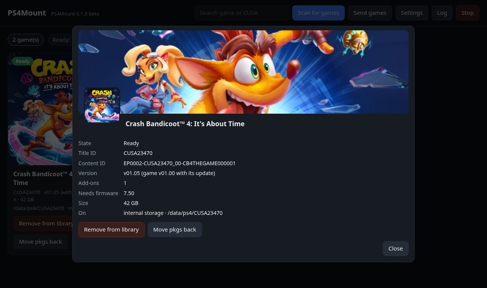

Buttons: **Remove from library** (takes it off the console and keeps its pkgs), **Add to library**, **Scan for games**, **Send games**, **Settings**, **Log**, **Stop** and, in the corner, **Connect Google Drive** (see below).

A game's page also has **Restore original files**: it undoes what PS4Mount did to its files. It takes the game off the console and puts its pkgs back where they were, with the names they had (for example `ps4/CUSA00092/app.pkg` becomes `PS4Mount/Flower/Flower.pkg` again). It is there to get your files back as they were, for example to install the game the usual way. Nothing is deleted, and PS4Mount does not pick those pkgs up again.

### Sending games from a computer

In the panel, **Send games**: drop the pkgs and pick where they go (the USB drive or the console's storage).

- Every pkg is **checked before it is sent**, in a second, from its first 4 MB: whether it is a fake PS4 pkg, a game, an update or an add-on, whether it is complete and whether it fits. Only the pkgs the console can use are sent. A pkg built for a newer firmware than yours is sent too, with a warning: it only runs with a backport.
- Games go first, then updates, then add-ons.
- A cancelled or failed send leaves no half file behind, and **Send again** retries it.
- When it arrives, the game is added by itself.

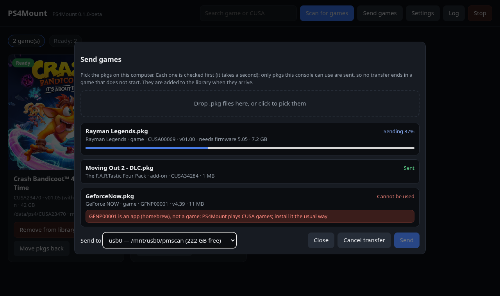

### Downloading from links

In the panel, **Download links**: paste the links, one per line, pick where to save it and press **Download**. The console downloads by itself: you can close the panel or turn the computer off.

- A **pkg**, a **ZIP** or a **RAR** will do, also in parts (`name.part1.rar`, `name.part2.rar`… or `name.rar`, `name.r00`, `name.r01`…). Paste all the parts, in any order: PS4Mount makes them one download and says when one is missing.
- The links must be **direct**: the ones that start the download when opened. A page with a download button (Mega, MediaFire and the like) will not do, and PS4Mount says so. When the link has no file name in it, add `|` and the name: `https://…/download?id=123 | game.pkg`.
- A RAR or a ZIP **is extracted while it downloads**, and only its pkgs come out (the rest, like a .txt or an .nfo, is left). The parts are kept until the end, so a cut download can go on; without room for the parts and the pkgs, each part is deleted once extracted (and a cut download starts again).
- The first 4 MB of each pkg get the **same check** as when sending from a computer (fake, complete…): a pkg that will not do stops the download there, without fetching the rest.
- It downloads over several connections at once, like Drive, and the console stays out of rest mode meanwhile. A lost connection goes on by itself; stopping PS4Mount, at its next load.
- At the end, the pkgs are in a folder named after the download in the drive's `PS4Mount` folder, and the game is added by itself.
- A RAR (5) with a **password**, also in parts and with its file list encrypted: write it in **Password** when adding it, or press **Try again** and write it when the download stopped for it. Not needed when it opened another download (they are kept in `/data/ps4mount/passwords.txt`) or when it is the site in brackets at the start of the name (`[SITE.COM]-game.part1.rar`: `[SITE.COM]`, `SITE.COM` and `site.com` are tried): those are tried by themselves. A wrong password shows from the first block, without downloading the rest.
- A ZIP with a password opens too, classic or AES, the same way as a RAR.
- Not possible: an older RAR (RAR4) with a password, a **7z**, or a link that needs a sign-in.

|  |  |
|---|---|

### Browser extension

Optional, for the computer: with it there is no need to look for the direct link. Press **Download** on any site, as always, and the download goes to the console instead of the computer.

- **Loading it** (it is not in the stores yet): download `ps4mount-extension.zip` from [Releases](https://github.com/Vld439/PS4Mount-PS4/releases) and unzip it. In Chrome, Brave or Edge: `chrome://extensions` → turn on **Developer mode** → **Load unpacked** → pick the folder. In Firefox: `about:debugging#/runtime/this-firefox` → **Load Temporary Add-on** → the `manifest.json` file (it goes away when Firefox closes).
- Press its icon, write the console's address, press **Connect** (the browser asks for leave to reach it) and pick where to save.
- A **pkg**, a **ZIP** or a **RAR** of its own goes to the console at once. The **parts of a RAR** wait in the icon's **basket**: download them all and press **Send**, with the password if it has one. Anything else (an .exe, a .pdf…) downloads to the computer as always.
- It sends the file's final address (after redirects) and cancels the download on the computer, so links that work only once do too.
- **Experimental:** fetching through the browser too. The console keeps downloading by itself and the browser hands it part of the blocks as well, with its cookies, over your network (port 8771). It helps only with sites that do not slow each connection down, and while the browser stays open; closed, the console goes on by itself.
- Chrome on Android and the iPhone have no extensions: from a phone, use the panel's **Download links**.

|  |  |
|---|---|

### Google Drive backups

Optional. Your games in **your own Google Drive**, to free space or keep them safe, and to download them back to the console whenever you want. The console uploads and downloads by itself: no computer needed, the panel works from a phone.

- **Back up to Drive** (at the top, once connected): uploads the whole library, each game with its update and add-ons. What Drive already has is skipped.
- **Send to Drive**, on a game's page: uploads that game.
- **Google Drive** (corner): your account, the space used and the games you have in Drive, each with **Download** (pick the drive: the USB drive or the console's storage) and **Delete from Drive** (to Drive's trash; nothing on the console is touched).

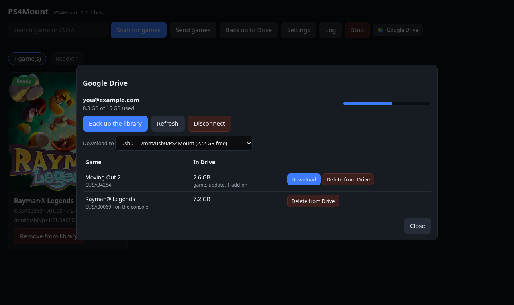

While it transfers, the panel shows the game, the percentage, the speed and the time left (the bar in the [first screenshot](#english) is a download), and the PS4 tells on its screen when it starts, at 25, 50 and 75% and when it ends. **The console does not go to rest mode** while a transfer runs, and you can play or use the panel meanwhile. If something cuts it (the network, stopping PS4Mount, a power off), **it goes on by itself** from where it was the next time PS4Mount loads. Every file is checked with its MD5 on the way up and down: a damaged file is never taken as good.

| Uploading a game | Its page while it uploads |
| --- | --- |
| 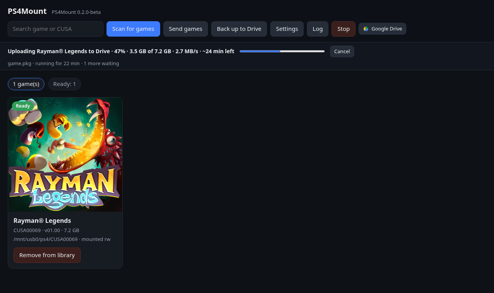 | 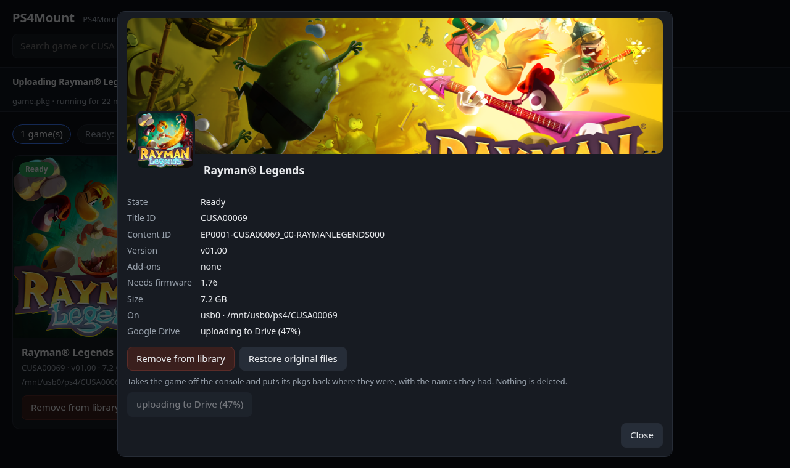 |

A download arrives in `PS4Mount/<Game> [CUSAxxxxx]/` of the chosen drive and PS4Mount adds it by itself (with the usual restart). A game already in the library is not downloaded over itself.

In Drive they are in the folder `PS4Mount/<Game> [CUSAxxxxx]/`, as `game.pkg`, `update.pkg` and `addon-….pkg`. PS4Mount uses Google's `drive.file` permission: **it only sees the files it creates**, nothing else of your Drive (so it does not see pkgs you put in Drive yourself either). See [PRIVACY.md](PRIVACY.md).

| | Speed measured (PS4 13.52, cable) |
| --- | --- |
| Upload | Your line's (2.8 MB/s on a 2.8 MB/s line: 7.2 GB in 45 min) |
| Download | ~15 MB/s, the PS4's most (12 connections at once): 60 GB in ~1 h 10 min |

#### Connecting your Google Drive (once)

PS4Mount ships no Google credentials: each user uses **their own**, which stay on their console only. They are free and take a few minutes (the screenshots are of Google Cloud in Spanish; the buttons are in the same places):

1. Open **[console.cloud.google.com](https://console.cloud.google.com/)** with your Google account, click the project picker (top left) → **New project**, name **PS4Mount** → **Create**. Check that PS4Mount is the project chosen at the top.

   <details><summary>See the screenshot</summary>

   

   </details>
2. In the search box at the top type **Google Drive API** → **Enable** (once enabled it says "API enabled" and the button is **Manage**).

   <details><summary>See the screenshots</summary>

   

   

   </details>
3. Menu ☰ → **APIs & Services** → **OAuth consent screen** (Google Auth Platform) → **Get started**: app name **PS4Mount**, your email, audience **External**, your contact email, agree to the policy → **Create**. Do not upload a logo (with one, Google asks to verify the app).

   <details><summary>See the screenshots</summary>

   

   

   

   

   

   </details>
4. **Clients** → **Create client** → type **TVs and Limited Input devices** (not "Desktop app" or "Web application": with those the console cannot sign in) → name **PS4Mount console** → **Create**. Copy the **Client ID** (it ends in `.apps.googleusercontent.com`) and the **Client secret** (download the JSON: the secret may not be shown again).

   <details><summary>See the screenshots</summary>

   

   

   </details>
5. **Audience** → **Test users** → **Add users** → your Google email → **Save**. (The app stays in "Testing": it does not need publishing or the branding section.)

   <details><summary>See the screenshot</summary>

   

   </details>
6. *(Optional)* **Data Access** → **Add or remove scopes** → tick `…/auth/drive.file` → **Update** → **Save**.

   <details><summary>See the screenshots</summary>

   

   

   </details>
7. In PS4Mount's panel: **Connect Google Drive** → paste the ID and the secret → **Save** → **Connect**. A code shows up: on your phone or computer open **google.com/device**, type it with the test account and allow it. Google warns that the app is not verified: it is your own app, click **Continue**.

| Pasting your client | The code for google.com/device |
| --- | --- |
| 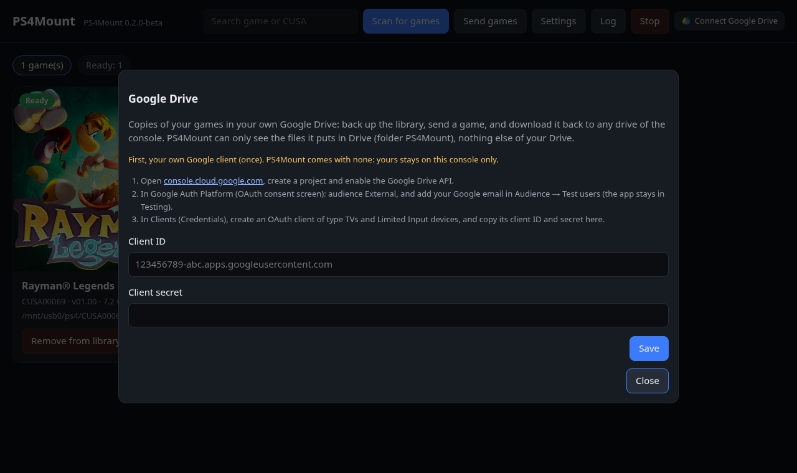 | 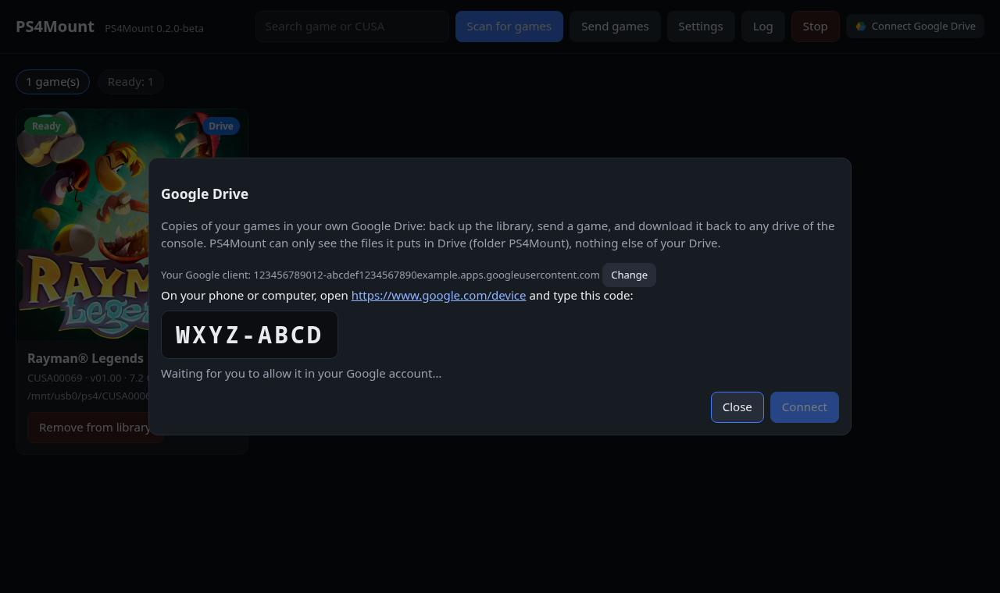 |

At google.com/device (on a phone or a computer; these are in Spanish, yours follow your Google language):

| 1. Type the code | 2. "Google hasn't verified this app": **Continue** |
| --- | --- |
|  |  |
| **3. The permission: only the files PS4Mount creates → Continue** | **4. Done: back to the panel** |
|  |  |

That is all: the panel shows your email and your space. The connection is kept on the console across restarts. Google may ask apps in "Testing" to connect again after a while: if it does, PS4Mount shows a new code **on the PS4's screen** to type at google.com/device, and whatever was transferring goes on after. **Disconnect** (in the Google Drive window) removes the access at Google and deletes it from the console; you can also remove it from your Google account (Security → Third-party connections).

### Settings

| Setting | Default | Meaning |
| --- | --- | --- |
| Folders to search for pkgs | `/PS4Mount` | Only used with **Organize** on: folders of each drive where new pkgs are picked up, one per line (`/` is the root: every game pkg in the root would be moved into `ps4/`). Two levels of subfolders are looked into. `ps4` cannot be used. Off (the default), the whole drive is searched, without renaming or moving anything. |
| Add new games in groups / Games per group | On / 5 | Adds many games in groups, which keeps the console stable. |
| Install add-ons (DLC) | On | Installs add-ons (see above). |
| Also install big add-ons | On | Add-ons over 256 MB are installed too, in the background: a game only sees an add-on the system has installed. They take internal space; there has to be room first. Off, they are not used. |
| Organize pkgs into the ps4 folder | Off | Moves the pkgs to `ps4/<TITLE_ID>/` to keep them in order. Off (the default), the pkgs are used where they are, with their own names, without moving or renaming anything; the ones PS4Mount had organized go back on their own to where they were (the ones you organized by hand stay in `ps4/`). On the console's storage, only `/data/PS4Mount` and `ps4` are searched. |
| Also use pkgs in the console's /data/PS4Mount | On | Uses the pkgs in the console's storage too. |
| NAS (NFS or SMB) | Off | Uses the pkgs in a shared network folder, **read only** and without moving or renaming anything (it does not show with Organize on). Firmware 13.52 only (see below). |
| Language | The console's | The language of the panel and the notifications: the console's, English or Spanish. |

They are saved in `/data/ps4mount/config.txt`. The settings also have **Restore the files of all games** (or of chosen ones) and **Use restored pkgs again**.

### Games from a NAS (SMB or NFS)

The games in a **shared folder on the network** (a Windows, Linux or macOS computer, or a NAS box such as Synology, QNAP or a router with USB) are played **from there**, with their update and add-ons, **without copying or installing them** on the console. It is **read only**: PS4Mount never writes to, renames or moves anything in the share. Firmware **13.52** only.

**1. Share the games folder** on the computer or NAS:

| Machine | How |
| --- | --- |
| **Windows** | Right-click the folder → Properties → Sharing → Advanced Sharing → tick **Share this folder**. Windows asks for an account: in the panel you enter your Windows user and password. If the console does not find the PC, set its network as **Private**. |
| **macOS** | System Settings → General → Sharing → turn on **File Sharing** and add the folder. In Options, turn on SMB sharing for your user. |
| **Linux** | Share the folder with **Samba** (read only, guest allowed) or **NFS** (`/etc/exports`), and let the console's address through the firewall. |
| **NAS box** | Turn on **SMB** (or NFS) file sharing in its settings and give the folder read access. |

**2. In the panel**, in **Settings → NAS**, press **Find servers on the network**. The console tries its whole network in a few seconds and lists the machines that share files. Pick one and its **shared folders** show up: pick the one with the games and press **Save**. When the server asks for an account the panel says so: fill in **User** and **Password** and press **List the server's shares**.

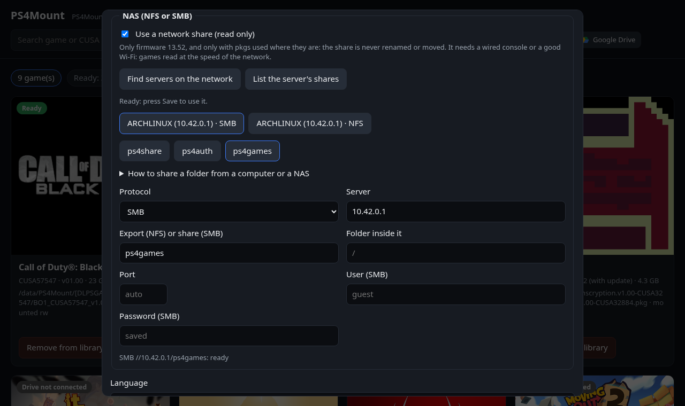

The games show up in the library like the ones on a USB drive (the first time, restart the console once). On their page, **On** says **NAS**:


The fields can be filled in by hand too:

| Field | What to enter |
| --- | --- |
| Protocol | **SMB** (Windows, macOS, most NAS boxes) or **NFS** (Linux, NAS boxes). |
| Server | The IP of the computer or NAS (`192.168.0.19`). |
| Export (NFS) or share (SMB) | For SMB, the share name (`games`). For NFS, the exported path (`/volume1/games`). |
| Folder inside it | Optional: a subfolder, so the whole share is not walked. |
| Port | Optional: leave it empty (445 for SMB, 2049 for NFS). |
| User and password (SMB) | Empty, it goes in as a guest. The password is saved in plain text in `config.txt`. |

- **Wired is best.** PS4Mount asks for the data ahead of time, several pieces at once, so it uses almost all of the network, but over Wi-Fi loading is slow and some textures take a moment. **Over a cable** games play as from the internal drive. With no switch or free router port, a **cable straight from the computer to the console** works too: share the computer's connection on that cable (on Linux with NetworkManager: `nmcli connection add type ethernet ifname <interface> con-name ps4 ipv4.method shared`; on Windows, "Internet Connection Sharing" on the Wi-Fi adapter), and set the PS4's wired network to **Easy**.
- **Firmware 13.52 only**: on others the setting is disabled (the console has no NFS, and the user-space file system, FUSE, cannot be switched on).
- **Only with Organize off** (the default): the share is never organized.
- **SMB** uses SMB2/3. **NFS** tries NFSv4.2, NFSv4.0 and NFSv3; for the panel to list the exports, the server needs `rpcbind` (otherwise type the export by hand).
- A server that **does not answer** (off, a mistyped address, a firewall) is reported in 3 seconds.
- **If the network drops** in the middle of a game (a cable pulled, the PC restarted), the game pauses and goes on by itself when it is back: PS4Mount reconnects and reopens the files. It waits up to 2 minutes; after that the game gets the error and may break.
- **Changing** the protocol, server or folder needs no restart: it reconnects right away.
- The share is mounted at `/mnt/usb0/ps4mount/nas-<n>`, a path the system's installer accepts. **No USB drive needs to be connected.**
- **BinLoader has to be on** in GoldHEN's menu: if PS4Mount starts with the console (AutoRun), that process cannot open the FUSE devices (a GoldHEN limitation), so PS4Mount loads itself again through BinLoader (port 9090), in a few seconds and without extra notices. With BinLoader off, games on USB drives and on the console's storage keep working, but the share is not mounted.
- **Loading PS4Mount again in the same boot** mounts the share in another folder (`nas-2`, `nas-3`…), and the NAS games ask for one restart. After a few loads in the same boot the FUSE devices run out: restart the console.
- When a game is **deleted on the console**, the pkgs in the share are not deleted (they are yours): the game leaves the library and the files stay on the NAS.

### Removing and deleting games

- **Deleting on the console** (Options → Delete, or Settings → Storage): deletes the game **and its pkgs** (game, update and add-ons) and frees the space, as with an installed game. Only when the delete is confirmed on those screens, and only that game's folder.
- **Remove from library** in the panel: takes the game off the console and **keeps its pkgs**, to add it again with **Add to library**.

While the delete screens are open, PS4Mount unmounts the game folders, so the system's delete never reaches the pkgs: PS4Mount deletes them, and only that game's folder.

With "Organize" off, **deleting on the console does not delete your pkgs**: the game leaves the library and is marked as removed, and the `.pkg` files stay where they were (they are yours). **Restore original files** does not apply in that mode.

### Good to know

- **Load PS4Mount after every boot.** Without it, games cannot start (they stay on the home screen).
- **Close PS4Mount games before putting the console in rest mode**: rest mode powers the USB drive off.
- If you **unplug the USB drive**, its games stay on the home screen and the panel shows them as *Drive not connected*. When you plug it back, wait for the `usb0: … found` notification before starting them.
- If GoldHEN loads PS4Mount automatically and you load it again, you see `PS4Mount … is already running`: that is fine, the second one stops by itself.
- The panel has no password: anyone on your local network can open it. Do not expose port 8770 to the Internet.

<a name="troubleshooting"></a>
### Troubleshooting

| Problem | What to do |
| --- | --- |
| CE-32930-7 when starting a game just added | Restart the console once and load PS4Mount again. |
| "Cannot start the application" | Check that PS4Mount is running and that the game's drive is connected (PS4Mount says so when it is not). |
| The panel does not open | Use the **console's** IP, with `http://` in front and `:8770`, from the same network. |
| A pkg is not added | Read the log (panel → **Log**): it says why (not fake, needs another firmware, incomplete…). |
| Links: "the link opens a web page" | It is not the direct link: on the download page, copy the link of the button that starts the download (or the one your browser shows in Downloads). |
| Links: "the server refused the link (403)" | Many links expire or work for one browser only: make a new one and press **Try again** or paste it again. |
| A game crashes or loses saves when installed the normal way too | It is the pkg (or its backport), not PS4Mount: try another dump. |
| Google Drive: `invalid_client` when connecting | The client is not of type **TVs and Limited Input devices**, or the ID/secret were copied wrong: make one of that type and paste it again. |
| Google Drive: "access blocked" or "access_denied" | Add your email in **Audience → Test users** of the project. |
| Google Drive: a download says "arrived damaged" | PS4Mount already tried twice from the start; press Download again later. |

To report a problem, open an [issue](https://github.com/Vld439/PS4Mount-PS4/issues) with the PS4Mount version, the firmware, the game (`CUSA…`), what happened and the log (panel → **Log**, or `/data/ps4mount/log.txt` over FTP). Do not attach pkgs or links to them.

### Files on the console

| File | Use |
| --- | --- |
| `/data/ps4mount/log.txt` | The log |
| `/data/ps4mount/config.txt` | The settings |
| `/data/ps4mount/stop` | Empty: stops PS4Mount |
| `/data/ps4mount/klog_all` | Empty: copies the whole system log into PS4Mount's log (diagnosis) |
| `/data/ps4mount/drive_client.txt` | Your Google client ID and secret |
| `/data/ps4mount/drive.txt` | The connection with your Google account |
| `/data/ps4mount/drive_queue.txt`, `drive_upload.txt` | Unfinished Drive transfers (to go on with them) |
| `<scan folder>/.ps4mount-drive/` | Unfinished Drive downloads |
| `/data/ps4mount/links_queue.txt` | Downloads from links still to do (with their links and the password written) |
| `/data/ps4mount/passwords.txt` | The passwords that opened an archive, tried on the next ones |
| `/mnt/usb0/ps4mount/nas-<n>` | Where the network share is mounted, inside the USB drive (its name is kept in `/data/ps4mount/nas-mnt`) |
| `<scan folder>/.ps4mount-links/` | Unfinished downloads from links |
| `/system_data/ps4mount/` | The games' internal folders |

## Building

```
bash test/run.sh        # tests on the computer (SANITIZE=1 for ASan/UBSan)
bash test/policy.sh     # the project's rules
cd test/web && npm test # the panel
PS4_PAYLOAD_SDK=/path/to/sdk bash build.sh   # build/ps4mount-ps4.elf and .bin
```

You need the [ps4-payload-sdk](https://github.com/ps4-payload-dev/sdk) **built from git**: the v0.9 release does not start on 13.52 (its runtime knows firmwares up to 13.50). CI uses the commit in `SDK_COMMIT` of `.github/workflows/build.yml`. [AI-WORKFLOW.md](AI-WORKFLOW.md) explains how to work on PS4Mount with an AI assistant.

## Credits

- **[PS4Mount](https://github.com/gasb07/ps4mount)** by **gasb07**: the project this port comes from (pkg reading, the install files, mounting, the panel). Its history is in the original project and in this repository's git history.
- **[LibOrbisPkg](https://github.com/maxton/LibOrbisPkg)** (maxton, LGPL-3.0): the fake pkg key (`src/keys.h`) and the reference for the format.
- **[ps4-payload-sdk](https://github.com/ps4-payload-dev/sdk)** (John Törnblom, GPL-3.0-or-later): the toolchain and the payload runtime.
- **flatz**: the BGFT interface documented in [ps4_stub_lib_maker_v2](https://github.com/flatz/ps4_stub_lib_maker_v2), and **[ps4-ipi](https://github.com/0x199/ps4-ipi)** as a reference for its use, to install add-ons.
- **[SQLite](https://sqlite.org)** (public domain): reading the console's database.
- **[BearSSL](https://bearssl.org)** (Thomas Pornin, MIT): the TLS the console talks to Google Drive and to the links' websites with.
- **[libarchive](https://www.libarchive.org)** (BSD-2-Clause) and **[zlib](https://zlib.net)** (zlib license): reading RARs and ZIPs while they download.
- **Mozilla's list of certificate authorities** (MPL-2.0): the roots the console trusts for links.
- **[ShadowMountPlus](https://github.com/drakmor/ShadowMountPlus)** (drakmor): the original's inspiration for mounting games from USB drives.
- **[libsmb2](https://github.com/sahlberg/libsmb2)** and **[libnfs](https://github.com/sahlberg/libnfs)** (Ronnie Sahlberg, LGPL-2.1): the NAS's SMB and NFS clients.
- **[libfuse](https://github.com/libfuse/libfuse)** 2.9 (LGPL-2.1) with the PS4 port from **[Itemzflow](https://github.com/LightningMods/Itemzflow)** (LightningMods, GPL-3.0): the user-space file system and the 13.52 patch that enables fusefs.

## License

GPL-3.0-or-later (see [LICENSE](LICENSE)). If you publish your own version, keep the notices, distribute the changes under the same license and, please, mention gasb07 and link the original project.
